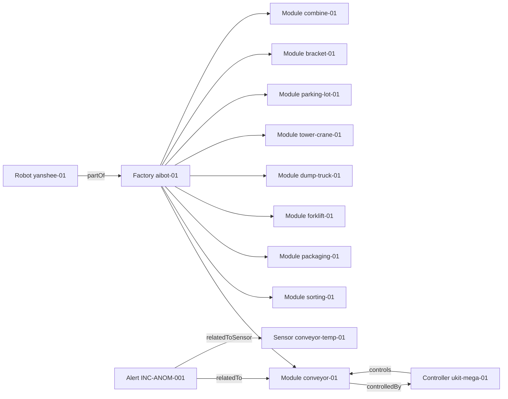

# Context Visualization & Research Report Template — FIWARE Factory Context

**Owner:** Issue #204 (SPEC-5)
**Version:** 1.0.0
**Status:** Draft — Ready for review
**Context:** ADR-0014, ADR-0016, `contracts/fiware/ngsi-ld-yanshee-context.md`

---

## Scope and honesty statement

This template renders the **materialised FIWARE context graph** of the
nine-module factory for research demonstrations and report figures.

> **What this is:** a visualisation of entities and relationships that exist
> in the Orion-LD context broker, together with their provenance and
> verification status.

> **What this is NOT:** semantic reasoning, inference, diagnosis or
> knowledge. **The existence of entities and relationships in a context
> broker is not evidence of reasoning.** No figure produced from this
> template may be captioned as "the system reasoned", "the system inferred",
> "the AI understood" or "semantic analysis". The system does not reason
> over this graph; it stores, projects and reads it.

Every figure must state its **evidence level** and its **data quality**:

| Label | Meaning |
|---|---|
| `L0` | Static / schema shape only. |
| `L1` | Host unit test. |
| `L2` | Simulation / mock device / broker double. |
| `L3` | Bench. |
| `L4` | HIL with a moving subsystem. |
| `L5` | Integrated factory → gateway → twin → robot. |
| `PHYSICAL` | Value observed from real hardware. |
| `SIMULATED` | Value produced by a simulator or fixture. |
| `UNKNOWN` | No verified source. Must not be rendered as a measurement. |

---

## 1. Report header

```markdown
# FIWARE Context Report — <lab / demo name>

**Generated:** <ISO-8601 timestamp>
**Fixture / dataset:** <fixture id and commit SHA>
**Broker:** Orion-LD <version> (<container image tag>)
**Evidence level:** L<n> — <environment description>
**Data quality:** <PHYSICAL | SIMULATED | UNKNOWN>
**Scope:** context graph only — no semantic reasoning is claimed
**Prepared by:** <name>
```

> The `Data quality` line is mandatory. A report that mixes simulated and
> physical values must say so per figure, not only in the header.

---

## 2. Nine-module relationship map

The nine-module catalogue from ADR-0014, rendered as the relationship graph
that is actually materialised in the broker.



### Rendering rules

- A node is drawn **only** if the corresponding entity exists in the broker
  at report time. Nodes that are not present are listed in
  §6 "Absent entities" instead of being drawn as if they were.
- Bracket is structural unless instrumented; it carries no synthetic control
  signals. Do not draw actuator or sensor relationships for it unless a
  verified sensor exists.
- Relationships are drawn only in the direction the broker holds them.

---

## 3. Per-module table

```markdown
| Module | Entity id | Status | Controlled by | Observed by | Data quality | Verified |
|---|---|---|---|---|---|---|
| Conveyor Belt | urn:ngsi-ld:Module:conveyor-01 | UNKNOWN | urn:ngsi-ld:Controller:ukit-mega-01 | urn:ngsi-ld:Sensor:conveyor-temp-01 | SIMULATED | no |
```

- `Status` shows `UNKNOWN` when no verified reading backs it. Do not
  substitute a plausible value.
- `Observed by` is empty when no verified sensor exists (ADR-0014 invariant
  3). Bracket is always empty here today.
- `Verified` reflects `verificationStatus` on the entity.

---

## 4. Robot capability panel

Rendered from the `Robot` entity (`contracts/fiware/ngsi-ld-yanshee-context.md` §1).

```markdown
| Field | Value | Verification |
|---|---|---|
| Robot | urn:ngsi-ld:Robot:yanshee-01 | — |
| Status | UNKNOWN | UNVERIFIED |
| Battery | UNKNOWN | UNVERIFIED |
| Supported actions | (none) | UNVERIFIED |
| Verification source | unverified-no-sdk-audit | — |
| Data quality | UNKNOWN | — |
| E-stop | not observed | — |
```

> **Required caption:** "Robot capability is unverified. The Yanshee SDK
> audit (Issue #159/#160) is not complete, so no robot state has been
> observed. Values shown as `UNKNOWN` are not measurements."

Do not present the unverified panel as a robot state readout. Until Issue
#160 lands, this panel documents an **absence of observation**.

---

## 5. Incident evidence panel

Rendered from the projected `Alert` entities.

```markdown
| Alert | Severity | Status | Operator state | Trace id | Source event | Module | Data quality |
|---|---|---|---|---|---|---|---|
| INC-ANOM-001 | critical | active | unacknowledged | trace-anom-001 | evt-anom-001 | urn:ngsi-ld:Module:conveyor-01 | SIMULATED |
```

The `Trace id` and `Source event` columns are the provenance backbone: they
let a reviewer walk from the figure back to the originating Gateway event in
the event store.

---

## 6. Absent entities

Entities the report **does not** show, and why. This section is mandatory
and prevents a reader from inferring coverage that does not exist.

```markdown
| Not shown | Reason |
|---|---|
| Sensor entities for bracket-01 | Bracket is structural and uninstrumented (ADR-0014). |
| Verified robot readings | Yanshee SDK audit incomplete (Issue #159/#160). |
| Live physical telemetry | No hardware in this run; all values are SIMULATED. |
```

---

## 7. Transport and provenance trace

Attach the raw scenario trace produced by
`integration-tests/fiware/test_fiware_yanshee_scenario.py` (JSON). It records
every hop in order:

```
sensor-anomaly → gateway-incident → orion-upsert → orion-get
→ subscriber-alert → gateway-approval → response-policy → yanshee-notification
```

Include the trace verbatim. A figure without its trace is not reproducible
evidence.

---

## 8. Required figure captions

Every figure in the report must carry a caption in this form:

> **Figure N.** <What is drawn>. Source: FIWARE/Orion-LD context,
> <fixture id @ commit>. Evidence level: **L<n>**. Data quality:
> **<PHYSICAL|SIMULATED|UNKNOWN>**. Shows entity and relationship presence
> only — not semantic reasoning.

Explicitly forbidden captions include "the system analysed", "the system
reasoned", "semantic understanding", "inferred", "diagnosed the cause" and
"AI-decided", unless a separate, evidenced mechanism is cited (none exists
in the current system).

---

## 9. Reproducibility record

```markdown
| Item | Value |
|---|---|
| Repository commit | <SHA> |
| Orion-LD image | quay.io/fiware/orion-ld:<tag> |
| MongoDB image | mongo:<tag> |
| Gateway package version | iot-gateway <version> |
| Robot package version | edge-ai-robot <version> |
| Fixture | <fixture path> |
| Command | <exact command to regenerate the figures> |
| Raw logs | <path to logs / trace> |
```

---

## 10. Research KPI table (context-only metrics)

Metrics that this context layer can legitimately produce. Each must state
how it was measured.

```markdown
| Metric | Value | Method | Evidence level |
|---|---|---|---|
| Context propagation delay (sensor → alert entity) | <measured> | <method> | L2 |
| Context-to-decision delay (alert entity → policy decision) | <measured> | <method> | L2 |
| Stale-context rejection rate | <measured> | <method> | L1 |
| Provenance completeness (traceId + sourceEventId present) | <measured> | <method> | L1 |
```

> These are **context-layer** metrics. They say nothing about physical
> factory throughput, robot task success or sync latency to the 3D twin
> unless the measurement method explicitly covers it. Do not mix metric
> families in one table without labelling them.

---

## 11. Limitations

State them explicitly. The expected baseline for this deliverable:

- The robot capability panel is unverified (Issue #159/#160).
- All values in an L2 run are `SIMULATED`; no physical observation is
  included.
- The context layer is a read model. It is not the authorization truth and
  it does not drive physical actions (ADR-0006, ADR-0014).
- Notification dispatch requires a Gateway-approved incident outbox record;
  a context change alone dispatches nothing.
- The Orion-LD broker is not exposed to public networks; Issue #200 owns the
  auth boundary and tenancy.

---

## References

- `contracts/fiware/ngsi-ld-yanshee-context.md` — robot/alert contract and
  provenance rules.
- `contracts/fiware/ngsi-ld-entity-schema.md` — base entity schema (Issue
  #197).
- `docs/adr/adr-0014-fiware-orion-ld-context.md` — context architecture.
- `docs/adr/adr-0016-fiware-yanshee-context-mapping.md` — this mapping
  decision.
- `docs/testing-and-acceptance.md` — evidence levels.
- `docs/PROJECT_CONTEXT.md` §5 — research measurement rules.
