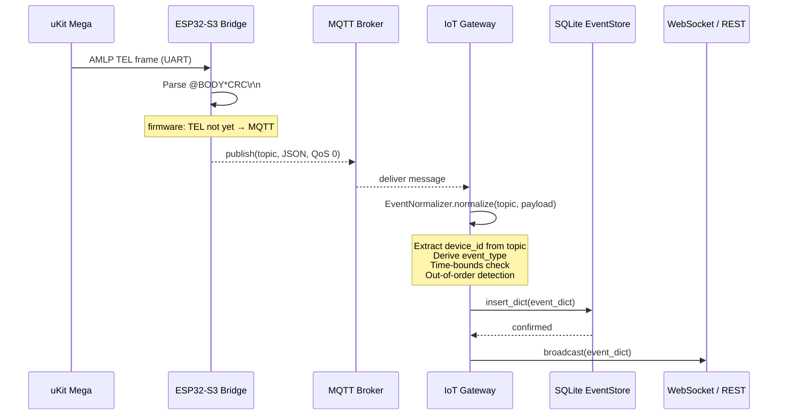
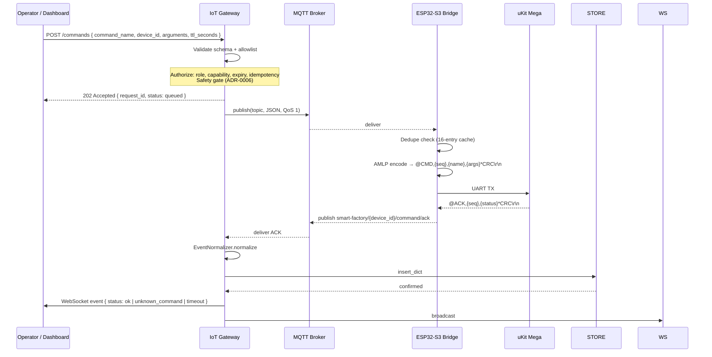
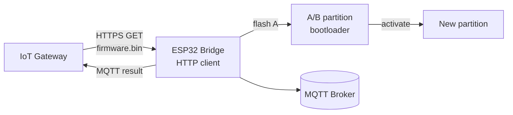
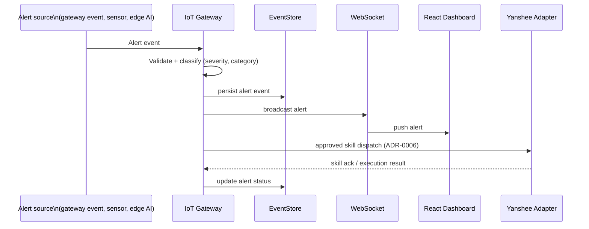
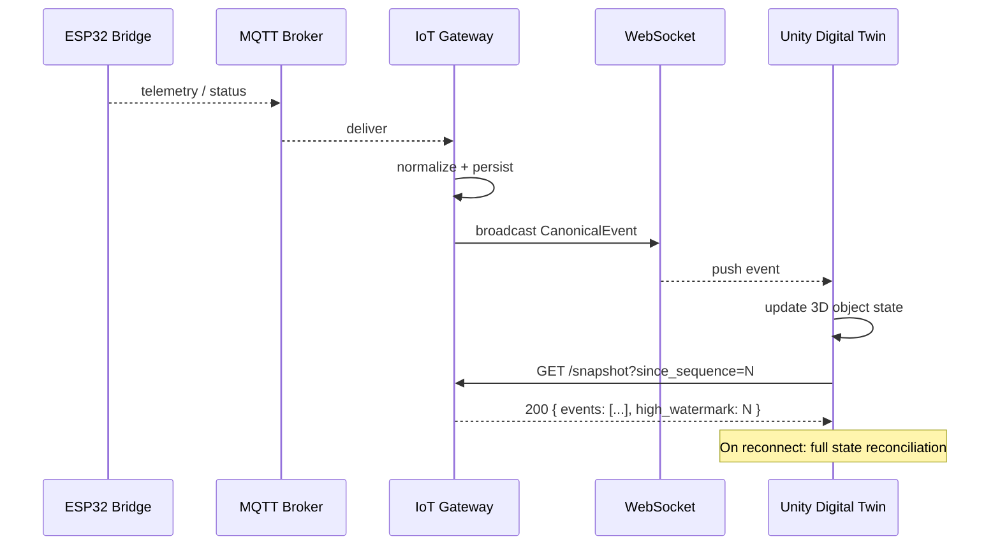
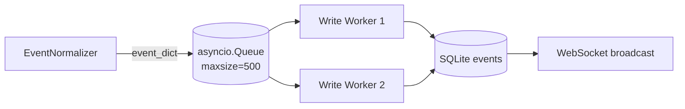
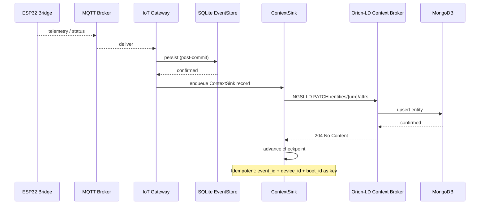
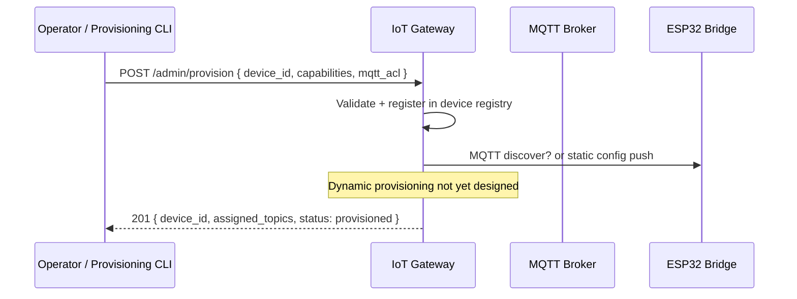
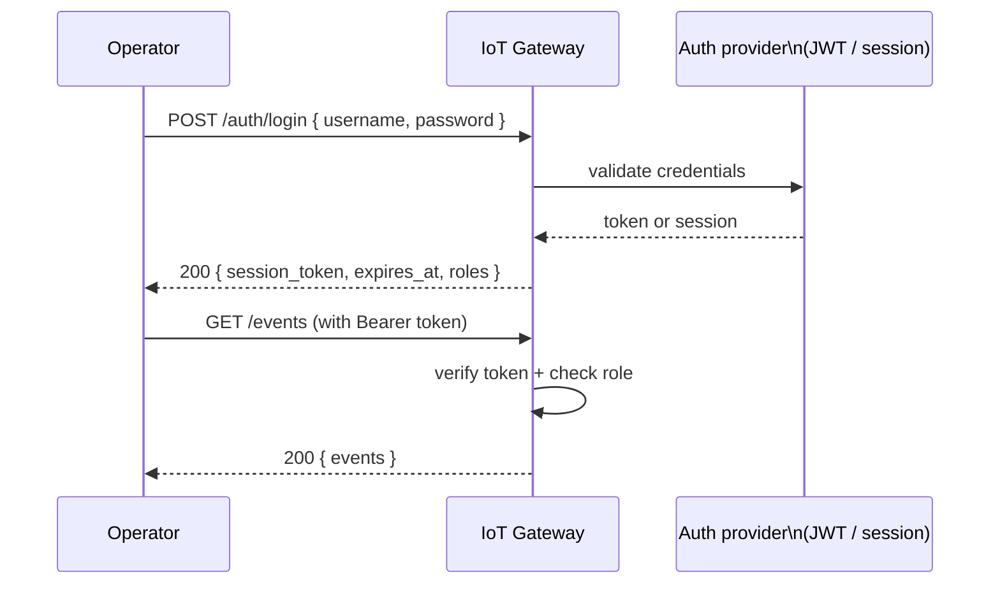

# Gateway Canonical Flows — Contract Matrix

**Status:** Proposed
**Issue:** [#163](https://github.com/vinhphan812/smart-factory/issues/163)
**Owner:** `iot-gateway`
**Dependencies:** ADR-0005, ADR-0010, ADR-0013, ADR-0014
**Verification level:** L0 (static/contract review)

---

## 1. Overview

This document defines the nine canonical data flows through the AIBOT Smart Factory IoT Gateway (`iot-gateway/`). Each flow is a typed, end-to-end contract: source system → wire format → gateway processing → output sink. The contracts are grounded in existing implementation (`iot-gateway/` source) and the merged ADRs. Where a flow is not yet wired in code, the design decision is recorded so implementation stays aligned.

**Evidence levels** (from `docs/testing-and-acceptance.md`):

| Level | Label | Meaning |
|-------|-------|---------|
| L0 | Static | Type-check, schema validation, lint |
| L1 | Unit | Component tests, no external dependency |
| L2 | Simulation | Service mocks, fixture data |
| L3 | Bench | Real hardware on bench, no production safety |
| L4 | HIL | Hardware-in-loop with safety guard |
| L5 | Integrated | Full system in production configuration |

---

## 2. System Context

```mermaid
flowchart TD
    subgraph Physical
        MEGA[uKit Mega controller]
        MODULE[9 physical modules\n(Forklift, Conveyor, …)]
        ESP[ESP32-S3 bridge]
    end

    subgraph Network
        MQTT[(MQTT Broker)]
    end

    subgraph Gateway
        INGEST[MQTT ingest\n+ validation]
        NORM[EventNormalizer\n+ time sync]
        STORE[(SQLite\nEventStore)]
        WEBSOCK[WebSocket\nbroadcast]
        HTTP[REST API\n/snapshot /events]
        CONTEXT[ContextSink\n→ Orion-LD]
    end

    subgraph Consumers
        TWIN[Unity Digital Twin]
        DASH[React Dashboard]
        YANSHEE[UBTECH Yanshee\n(alert + bounded skill)]
    end

    subgraph External
        ORION[FIWARE Orion-LD\nNGSI-LD Context Broker]
    end

    ESP <-->|AMLP UART 5V/3.3V| MEGA
    MEGA <-->|sensors/actuators| MODULE
    ESP <-->|JSON MQTT| MQTT
    MQTT --> INGEST
    INGEST --> NORM
    NORM --> STORE
    NORM --> WEBSOCK
    NORM --> HTTP
    STORE --> CONTEXT
    CONTEXT --> ORION
    WEBSOCK --> TWIN
    WEBSOCK --> DASH
    DASH -->|approved command| MQTT
    WEBSOCK -->|incident| YANSHEE
```

---

## 3. Module Ownership Matrix

| # | Flow | Primary owner | Supporting owners | Implementation status |
|---|------|--------------|-------------------|----------------------|
| 1 | Device telemetry ingestion | `esp32-ukit-bridge/` | `iot-gateway/` | ⚠️ Partial — TEL→MQTT not yet wired in firmware |
| 2 | Command dispatch | `iot-gateway/` | `esp32-ukit-bridge/`, `dashboard/` | 🔒 Planned |
| 3 | OTA update | `esp32-ukit-bridge/` | `iot-gateway/` | 🔒 Planned — ADR-0007/0008 design only |
| 4 | Alert/incident dispatch | `iot-gateway/` | `edge-ai-robot/`, `dashboard/` | 🔒 Planned — ADR-0013 |
| 5 | Physical module status | `iot-gateway/` | `digital-twin/` | 🔒 Planned |
| 6 | Event store persistence | `iot-gateway/` | all modules | ✅ Implemented |
| 7 | FIWARE context update | `iot-gateway/` | `infrastructure/` (FIWARE) | 🔒 Planned — ADR-0014 |
| 8 | Device provisioning bootstrap | `iot-gateway/` | `esp32-ukit-bridge/` | 🔒 Planned |
| 9 | Operator authentication | `iot-gateway/` | `dashboard/` | 🔒 Planned |

**Legend:**
- ✅ Implemented — code + tests exist in `iot-gateway/`
- ⚠️ Partial — code path wired but not yet production-ready or hardware-verified
- 🔒 Planned — design decided (ADR/contract), no production implementation yet

---

## 4. Contract Status Matrix

| Flow | Request schema | Response schema | Direction | QoS | Retained | Auth required |
|------|---------------|----------------|-----------|-----|----------|--------------|
| 1 — Telemetry ingestion | `telemetry.schema.json` | — | bridge → gateway | 0 | No | MQTT username+password |
| 2 — Command dispatch | `command.schema.json` | `device-event.schema.json` | dashboard → gateway → bridge | 1 | No | MQTT ACL + gateway auth |
| 3 — OTA update | `ota.schema.json` | `ota-result.schema.json` | gateway → bridge | 1 | No | TLS client cert |
| 4 — Alert dispatch | `alert.schema.json` | `alert-ack.schema.json` | gateway → Yanshee + dashboard | 0 | No | gateway API key |
| 5 — Module status (twin) | `snapshot.schema.json` | — | gateway → Unity (WS) | — | — | WebSocket token |
| 6 — Event store persist | internal envelope | — | internal | — | — | — |
| 7 — FIWARE context | internal envelope | NGSI-LD PATCH | gateway → Orion-LD | — | — | internal HTTP |
| 8 — Provisioning bootstrap | `provision.schema.json` | `provision-result.json` | admin → gateway → bridge | 1 | No | gateway admin auth |
| 9 — Operator auth | `auth.schema.json` | `session.schema.json` | operator → gateway | — | — | TLS |

---

## 5. Canonical Flows

---

### Flow 1 — Device Telemetry Ingestion

**device → bridge → gateway**

> ⚠️ **Partial implementation:** The ESP32 bridge firmware does not yet wire AMLP `TEL` frames to MQTT publish. The contract below describes the target design; `iot-gateway/src/iot_gateway/config.py` already subscribes to `smart-factory/+/telemetry` and `EventNormalizer` handles the wire format. ADR-0009 tracks the known telemetry schema mismatch.

#### 5.1 Flow diagram



#### 5.2 Ownership

| Aspect | Owner |
|--------|-------|
| AMLP TEL parsing | `esp32-ukit-bridge/` |
| UART→MQTT wiring | `esp32-ukit-bridge/` |
| Topic schema | `contracts/v1/schemas/telemetry.schema.json` |
| Gateway normalizer | `iot-gateway/src/iot_gateway/event_normalizer.py` |
| Event store | `iot-gateway/src/iot_gateway/event_store.py` |

#### 5.3 Input contract (bridge → gateway)

**Wire format:** JSON over MQTT, topic `smart-factory/{device_id}/telemetry`, QoS 0, not retained.

```json
{
  "device_id": "ukit-00000000",
  "received_at_ms": 123456,
  "values": ["CONVEYOR", "RUNNING", "60"],
  "pairs": { "SENSOR1": "1" }
}
```

| Field | Type | Description |
|-------|------|-------------|
| `device_id` | string | Bridge identity, derived from ESP32 MAC (e.g. `ukit-00000000`) |
| `received_at_ms` | integer | **Monotonic uptime in ms** — NOT UTC. Used for ordering, NOT for latency computation. |
| `values` | string[] | Raw plain fields from AMLP TEL body (max 6, excess silently dropped) |
| `pairs` | object | Key=value fields from AMLP TEL body (max 4, excess silently dropped) |

> ⚠️ `received_at_ms` is the ESP32 monotonic clock at frame-recognition time. It is **not UTC**. `EventNormalizer.is_timestamp_synchronized = False` for this source; `latency_ms` is set to `-1`. See `docs/issue-34-time-sync-gateway-contract.md`.

#### 5.4 Gateway normalization output

`EventNormalizer.normalize()` produces a `CanonicalEvent` (see `models.py`) with these canonical fields added:

| Field | Value |
|-------|-------|
| `event_id` | UUIDv4 |
| `event_type` | `telemetry` |
| `device_id` | extracted from topic |
| `payload` | raw JSON payload |
| `mqtt_topic` | `smart-factory/{device_id}/telemetry` |
| `mqtt_timestamp_ms` | `received_at_ms` (monotonic — not UTC) |
| `event_timestamp_ms` | `received_at_ms` (monotonic) |
| `received_at` | gateway receive time in UTC ISO 8601 |
| `received_at_ms` | gateway receive time in ms UTC epoch |
| `latency_ms` | `-1` (monotonic source — undefined) |
| `stale` | computed from `time_bounds.threshold_for(device_id, event_type)` |
| `out_of_order` | `true` if `received_at_ms < last_device_timestamp_ms[device_id]` |
| `is_timestamp_synchronized` | `false` |
| `sequence` | monotonic integer (normalizer-assigned, persisted in DB) |
| `ingested_at` | UTC ISO 8601 at gateway receive |

#### 5.5 Error handling

| Error | Gateway behaviour |
|-------|-----------------|
| Malformed JSON | Log warning, return `None`, drop message |
| Unknown topic pattern | Log warning, return `None`, drop message |
| Write queue full | Increment `_dropped_count`, log warning, drop message |
| SQLite write failure | Log exception in write worker, retry next message |

#### 5.6 Retry strategy

Telemetry is fire-and-forget (QoS 0). No gateway-level retry. ESP32 bridge does not retransmit lost telemetry frames. Stale detection is the consumer's responsibility: Unity marks telemetry stale when no new frame arrives within `kTelemetryTimeoutMs` (60 s, configurable in `bridge_config.h`).

---

### Flow 2 — Command Dispatch

**dashboard → gateway → bridge → device**

> 🔒 **Planned.** The gateway does not yet expose a command API. Design based on `contracts/v1/schemas/command.schema.json` and `contracts/v1/command-lifecycle.md`. A gateway command façade (REST → MQTT publish) must be added to `iot-gateway/`. SafetyGate integration gap documented in ADR-0013 §Integration Gap.

#### 5.7 Flow diagram



#### 5.8 Ownership

| Aspect | Owner |
|--------|-------|
| Command API façade | `iot-gateway/` |
| Authorization / safety gate | `iot-gateway/` |
| MQTT publish | `iot-gateway/` or direct dashboard→broker |
| Command schema | `contracts/v1/schemas/command.schema.json` |
| Command lifecycle | `contracts/v1/command-lifecycle.md` |
| Bridge firmware | `esp32-ukit-bridge/` |

#### 5.9 Input contract (dashboard → gateway)

**Interface:** REST POST `/commands` (gateway façade) → MQTT publish to `smart-factory/{device_id}/command/down`

```json
{
  "command_id": 102,
  "correlation_id": "uuid-xyz",
  "device_id": "ukit-00000000",
  "command_name": "CONVEYOR_START",
  "arguments": ["60"],
  "timestamp": "2026-10-20T10:00:00Z",
  "ttl_seconds": 15
}
```

| Field | Type | Required | Description |
|-------|------|----------|-------------|
| `command_id` | integer (uint32) | Yes* | Primary correlation ID (1..4294967295). *One of `command_id` or `request_id` required |
| `request_id` | string (1..64) | Yes* | String correlation ID for UUID-based callers |
| `device_id` | string | No | Target device; routing is by topic, not this field |
| `command_name` | enum | Yes | One of: `CONVEYOR_START`, `CONVEYOR_STOP`, `RESET`, `PING`, `SET_OUTPUT` |
| `arguments` | string[] (max 2) | No | Positional args; printable ASCII 0x21..0x7E |
| `timestamp` | ISO 8601 UTC | No | Issued-at time; not used by bridge firmware |
| `ttl_seconds` | integer (1..300, default 10) | No | Wall-clock TTL; firmware uses fixed retry budget (planned: wall-clock enforcement) |

#### 5.10 Bridge MQTT → device (AMLP wire)

```
@CMD,{sequence},{command_name}[,{argument}...]*CRC\r\n

// CONVEYOR_START 60
@CMD,1,CONVEYOR_START,60*XXXX\r\n

// CONVEYOR_STOP
@CMD,2,CONVEYOR_STOP*XXXX\r\n

// SET_OUTPUT channel 5, value 1
@CMD,4,SET_OUTPUT,5,1*XXXX\r\n
```

#### 5.11 Command ACK output (bridge → gateway → dashboard)

**Wire:** MQTT, topic `smart-factory/{device_id}/command/ack`, QoS 0.

| Status | When |
|--------|------|
| `ok` | MEGA returned `ACK,<id>,OK` |
| `unknown_command` | MEGA returned `ACK,<id>,UNKNOWN_COMMAND` |
| `invalid_argument` | MEGA returned `ACK,<id>,INVALID_ARGUMENT` |
| `internal_error` | MEGA returned `ACK,<id>,INTERNAL_ERROR` |
| `timeout` | Bridge exhausted 3 retries with no MEGA ACK |
| `queue_full` | Immediate: command queue at capacity (8 entries) |
| `internal_error` (bridge) | Immediate: sequence allocation or queue operation failed |

```json
// Success
{ "request_id": "abc123", "sequence": 42, "command": "CONVEYOR_START",
  "status": "ok", "status_code": 0, "attempts": 1 }

// Failure
{ "request_id": "abc123", "sequence": 42, "command": "CONVEYOR_START",
  "status": "unknown_command", "status_code": 1 }

// Timeout
{ "request_id": "abc123", "sequence": 42, "command": "CONVEYOR_START",
  "status": "timeout" }
```

#### 5.12 Error handling

| Error | Gateway behaviour |
|-------|-----------------|
| Schema validation failure | 400 Bad Request |
| Unauthorized role/capability | 403 Forbidden |
| Safety gate reject | 403 Forbidden + log incident |
| Expired TTL | Drop, 408 Request Timeout |
| Duplicate request_id | Drop silently (idempotent, upstream must handle) |
| Bridge offline | MQTT broker holds QoS-1 message; gateway may return 202 if broker accepts |

#### 5.13 Retry strategy

- **ESP32 bridge:** Fixed retry, 3 attempts at 1000 ms intervals. `ttl_seconds` wall-clock enforcement is planned (ADR-0005 notes `ttl_seconds` is accepted but not yet enforced in firmware).
- **Gateway façade:** No gateway-level MQTT retry (QoS 1 handles broker retry). Caller implements timeout + exponential back-off if no ACK received.
- **Idempotency:** `request_id` / `command_id` in 16-entry bridge deduplication cache prevents double-execution.

---

### Flow 3 — OTA Update

**gateway → bridge → device**

> 🔒 **Planned.** Design documented in ADR-0007 (signed OTA A/B rollback) and ADR-0008 (event-driven OtaManager). No production implementation yet.

#### 5.14 Flow diagram



#### 5.15 Ownership

| Aspect | Owner |
|--------|-------|
| OTA firmware images | `esp32-ukit-bridge/` |
| Signed image pipeline | `infrastructure/` |
| Gateway OTA API | `iot-gateway/` |
| OTA manifest + version registry | `contracts/gateway/ota-manifest.json` |

#### 5.16 Input contract (gateway → bridge)

**Interface:** ESP32 HTTP client pulls from gateway OTA server, or gateway POSTs to bridge command topic.

```json
{
  "command_name": "OTA_UPDATE",
  "arguments": ["https://gateway.local/ota/v1.2.0/firmware.bin", "sha256:abc123..."]
}
```

#### 5.17 Error handling

| Error | Behaviour |
|-------|-----------|
| Checksum mismatch | Bridge rejects, publishes `status: checksum_failed` |
| A/B partition full | Rollback to previous partition |
| Network timeout | Bridge retries with exponential backoff (planned: ADR-0008) |
| Boot failure | Bootloader rolls back to previous partition |

#### 5.18 Retry strategy

Bridge retries download on network failure. A/B partitions ensure atomic rollback. Gateway does not retry dispatch — bridge is the source of truth for OTA completion.

---

### Flow 4 — Alert / Incident Dispatch

**gateway → robot (Yanshee) + dashboard**

> 🔒 **Planned.** Gateway incident/alert API (`alerts.py` planned). Yanshee adapter (`edge-ai-robot/`) pending hardware verification (Issue #159). Bounded skill architecture from ADR-0006 / ADR-0013.

#### 5.19 Flow diagram



#### 5.20 Ownership

| Aspect | Owner |
|--------|-------|
| Alert classification | `iot-gateway/` |
| Bounded skill policy | `iot-gateway/` (ADR-0006, ADR-0013) |
| Yanshee adapter | `edge-ai-robot/` (pending #159/#160) |
| Dashboard push | `dashboard/` |
| Alert persistence | `iot-gateway/` |

#### 5.21 Input contract (alert trigger → gateway)

Alerts are generated internally by `EventNormalizer` (stale event, out-of-order, error payloads) or by the edge AI detector. Alert schema (planned):

```json
{
  "alert_id": "uuid-v4",
  "device_id": "ukit-00000000",
  "severity": "critical | warning | info",
  "category": "stale_telemetry | command_failed | anomaly_detected | safety_violation",
  "message": "Human-readable description",
  "trigger_event_id": "uuid-of-source-event",
  "timestamp": "2026-10-20T10:00:00Z"
}
```

#### 5.22 Yanshee bounded skill contract

Per ADR-0006 and ADR-0013: only pre-approved, bounded skills may be dispatched to Yanshee. Skills are **fail-closed**: any skill not explicitly allowed is denied. Physical safety skills (E-stop, motor override) are **never AI-dispatchable**.

Allowed skill categories: notification, status acknowledgment, simple info retrieval. Not allowed: direct motor control, safety override, physical actuator commands.

#### 5.23 Error handling

| Error | Behaviour |
|-------|-----------|
| Yanshee offline | Alert queued for retry (bounded), dashboard notified of robot unreachable |
| Unauthorized skill | Log + deny; do not dispatch |
| Alert persist failure | Log error, continue (alert dispatch is best-effort) |

#### 5.24 Retry strategy

Yanshee dispatch: 3 attempts with exponential backoff (1 s, 2 s, 4 s). After max attempts, alert marked `robot_unreachable`, dashboard notified.

---

### Flow 5 — Physical Module Status (Unity Twin)

**gateway ↔ Unity Digital Twin**

> 🔒 **Planned.** Gateway exposes REST `/snapshot` and WebSocket broadcast. Unity Digital Twin (`digital-twin/`) consumes these. ADR-0012 (Unity prefab contracts) and ADR-0003 (Unity engine) apply.

#### 5.25 Flow diagram



#### 5.26 Ownership

| Aspect | Owner |
|--------|-------|
| Event broadcast | `iot-gateway/` (WebSocket) |
| Snapshot REST API | `iot-gateway/src/iot_gateway/api.py` |
| Unity WebSocket client | `digital-twin/` |
| State mapping | `digital-twin/` |

#### 5.27 REST contract: GET /snapshot

| Parameter | Type | Description |
|-----------|------|-------------|
| `since_sequence` | integer | Return events with `sequence > since_sequence`. Use 0 for full snapshot. |
| `device_id` | string | Filter to one device (optional) |
| `event_type` | string | Filter by type (optional) |
| `limit` | integer | Max events (default 1000) |

**Response:**
```json
{
  "events": [/* array of CanonicalEvent dicts */],
  "high_watermark": 12345,
  "per_device_latest": {
    "ukit-00000000": { /* CanonicalEvent */ }
  }
}
```

#### 5.28 WebSocket contract

**Endpoint:** `ws://gateway:8000/`

Server pushes individual `CanonicalEvent` dicts as JSON. Client should:
1. On connect: call `GET /snapshot?since_sequence=0` to establish full state
2. Apply each pushed event sequentially
3. On disconnect: reconnect and call `/snapshot?since_sequence=<last_watermark>`

#### 5.29 Error handling

| Error | Behaviour |
|-------|-----------|
| Twin disconnects | Gateway continues broadcast (no state loss); twin reconnects via snapshot |
| Snapshot gap detected | Twin must re-fetch full snapshot, not apply gap |
| Stale telemetry | Event `stale: true` flag signals twin to show UNKNOWN state, not infer |

#### 5.30 Retry strategy

Gateway WebSocket is stateless push. Reconnection + snapshot is the client's responsibility. Gateway stores events in SQLite up to `MAX_EVENTS` (default 10,000) for recovery.

---

### Flow 6 — Event Store Persistence

**All flows converge here**

> ✅ **Implemented** in `iot-gateway/src/iot_gateway/event_store.py`.

#### 5.31 Flow diagram



#### 5.32 Ownership

| Aspect | Owner |
|--------|-------|
| EventStore class | `iot-gateway/src/iot_gateway/event_store.py` |
| Schema | `models.py`, `event_store.py` EventRecord SQLAlchemy model |
| Write queue | `gateway.py` `_write_queue` (max 500) |

#### 5.33 Stored schema

`EventRecord` table columns:

| Column | Type | Description |
|--------|------|-------------|
| `event_id` | TEXT PK | UUIDv4 |
| `device_id` | TEXT IDX | Device identifier |
| `event_type` | TEXT IDX | Canonical event type string |
| `payload` | JSON | Raw wire payload |
| `mqtt_topic` | TEXT | Original MQTT topic |
| `mqtt_timestamp_ms` | INTEGER | Source timestamp (may be monotonic) |
| `event_timestamp_ms` | INTEGER | Normalized source timestamp |
| `received_at` | DATETIME TZ | Gateway receive time |
| `latency_ms` | INTEGER | Transit latency in ms (-1 if undefined) |
| `stale` | INTEGER | 1 if stale, 0 if fresh |
| `out_of_order` | INTEGER | 1 if out-of-order, 0 if in-order |
| `ingested_at` | DATETIME TZ | Canonical ingest timestamp |
| `sequence` | INTEGER IDX | Monotonic global sequence |

#### 5.34 Error handling

| Error | Behaviour |
|-------|-----------|
| SQLite write failure | Log exception in write worker; do not crash worker; item is dequeued and discarded |
| Queue full | Caller increments `_dropped_count`, logs warning, drops message |
| Retention limit exceeded | `_prune_old_events()` deletes oldest by sequence |

#### 5.35 Retry strategy

No retry. SQLite writes are durable; failures are logged and the event is dropped. Consumers (Unity, dashboard) recover via snapshot on reconnect.

---

### Flow 7 — FIWARE Context Update

**gateway → Orion-LD**

> 🔒 **Planned.** Design per ADR-0014. Implementation tracked in Issue #198. No production code yet.

#### 5.36 Flow diagram



#### 5.37 Ownership

| Aspect | Owner |
|--------|-------|
| ContextSink | `iot-gateway/src/iot_gateway/fiware/context_sink.py` (planned) |
| ContextMapper | `iot-gateway/src/iot_gateway/fiware/context_mapper.py` (planned) |
| ContextReconciler | `iot-gateway/src/iot_gateway/fiware/context_reconciler.py` (planned) |
| Orion-LD deployment | `infrastructure/fiware/` (planned) |
| Entity schema | `infrastructure/fiware/contexts/v1/context.jsonld` (planned) |

#### 5.38 Input contract (gateway → Orion-LD)

**Interface:** Internal HTTP POST from ContextSink to Orion-LD NGSI-LD endpoint.

NGSI-LD PATCH on entity URN (ADR-0014 §NGSI-LD entity graph):

```json
{
  "operationalState": {
    "type": "Property",
    "value": "RUNNING",
    "observedAt": "2026-10-20T10:00:00Z"
  }
}
```

Target URN: e.g. `urn:ngsi-ld:Module:conveyor-01`

#### 5.39 Error handling

| Error | Behaviour |
|-------|-----------|
| Orion-LD unavailable | ContextSink retains record in durable queue; ingestion continues |
| MongoDB unavailable | Orion-LD returns error; ContextSink retries with backoff |
| Stale event (old boot/sequence) | Discard; do not overwrite newer state |
| Invalid entity URN | Log + quarantine; do not block sink |
| Idempotency violation | Quarantine duplicate event_id; log |

#### 5.40 Retry strategy

ContextSink maintains a durable outbox keyed by `event_id`. On Orion-LD failure: exponential backoff (1 s, 2 s, 4 s, max 5 min). After 10 failures: quarantine, alert, stop retrying that event. `ContextReconciler` recovers from SQLite authoritative log on restart.

---

### Flow 8 — Device Provisioning Bootstrap

**admin → gateway → bridge**

> 🔒 **Planned.** SPIFFS device registry (ADR-0002 §Device registry) not yet wired. Bridge topics are currently hard-coded in `MqttBridge::begin()`. Issue #169 tracks the device capability registry.

#### 5.41 Flow diagram



#### 5.42 Ownership

| Aspect | Owner |
|--------|-------|
| Device registry | `iot-gateway/` (planned, Issue #169) |
| Bridge provisioning | `esp32-ukit-bridge/` (SPIFFS registry, planned) |
| ACL management | MQTT broker ACL |

#### 5.43 Input contract

```json
{
  "device_id": "ukit-00000001",
  "device_type": "esp32-ukit-bridge",
  "capabilities": ["telemetry", "command", "ota"],
  "mqtt_acl": {
    "subscribe": ["smart-factory/ukit-00000001/command/down"],
    "publish": [
      "smart-factory/ukit-00000001/command/ack",
      "smart-factory/ukit-00000001/telemetry",
      "smart-factory/ukit-00000001/status"
    ]
  }
}
```

#### 5.44 Error handling

| Error | Behaviour |
|-------|-----------|
| Device already registered | 409 Conflict |
| Invalid device type | 400 Bad Request |
| ACL push to bridge fails | Mark device `provision_failed`, alert admin |

#### 5.45 Retry strategy

No automatic retry. Admin retries provisioning manually after bridge comes online.

---

### Flow 9 — Operator Authentication

**operator → gateway**

> 🔒 **Planned for full RBAC.** The gateway currently exposes `X-Operator-Token` header validation for SafetyGate endpoints (`_require_operator_token` in `api.py`), with `SAFETY_OPERATOR_TOKEN` from the environment. Dashboard session management is pending Issue #152.

#### 5.46 Flow diagram



#### 5.47 Ownership

| Aspect | Owner |
|--------|-------|
| Gateway auth middleware | `iot-gateway/` (planned) |
| JWT / session management | `iot-gateway/` (planned) |
| Dashboard SSO | `dashboard/` (planned, Issue #152) |
| Role definitions | `iot-gateway/` |

#### 5.48 Roles

| Role | Permissions |
|------|------------|
| `operator` | Read events, read snapshot, receive alerts |
| `engineer` | operator + issue commands (Flow 2) |
| `admin` | all permissions + provisioning (Flow 8) |
| `ai_robot` | limited alert ack only |

#### 5.49 Error handling

| Error | Behaviour |
|-------|-----------|
| Invalid credentials | 401 Unauthorized |
| Expired token | 401 Unauthorized + `token_expired` error code |
| Insufficient role | 403 Forbidden |
| Rate limit exceeded | 429 Too Many Requests |

#### 5.50 Retry strategy

Token refresh: 15-minute sliding expiry. No retry on auth failure — user must re-authenticate.

---

## 6. Shared Constants and Invariants

### 6.1 MQTT Topics

| Topic | Direction | QoS | Retained | Description |
|-------|-----------|-----|----------|-------------|
| `smart-factory/{device_id}/command/down` | dashboard → bridge | 1 | No | Command dispatch |
| `smart-factory/{device_id}/command/ack` | bridge → gateway | 0 | No | Command completion |
| `smart-factory/{device_id}/telemetry` | bridge → gateway | 0 | No | Periodic telemetry (⚠️ not yet wired) |
| `smart-factory/{device_id}/status` | bridge → gateway | 0 | **Yes** | LWT online/offline |
| `smart-factory/{device_id}/heartbeat` | bridge → gateway | 0 | No | Periodic heartbeat (planned) |

### 6.2 Gateway ports

| Port | Protocol | Description |
|------|----------|-------------|
| 8000 | WebSocket | Live event broadcast |
| 8001 | HTTP REST | `/events`, `/events/{id}`, `/snapshot`, `/health` |

### 6.3 Staleness thresholds (planned override via `TimeBounds`)

| Source | Default threshold | Rationale |
|--------|------------------|-----------|
| Telemetry | 60,000 ms (60 s) | `kTelemetryTimeoutMs` from bridge firmware |
| Command ACK | 15,000 ms | TTL default 10 s + 5 s margin |
| Status online | 300,000 ms (5 min) | Grace period for brief disconnects |
| Status offline | 0 ms (immediate) | Any offline event is immediately actionable |

### 6.4 Sequence and ordering invariants

1. **`event_id`** is a UUIDv4 — globally unique, never reused.
2. **`sequence`** is a monotonic integer assigned by the gateway normalizer. It is persisted in SQLite and survives restarts via `gateway_metadata` table.
3. **Ordering anchor:** `received_at_ms` (gateway UTC) for ordering. Do not use `mqtt_timestamp_ms` for ESP32 telemetry (monotonic, not UTC).
4. **Out-of-order detection:** `EventNormalizer` flags `out_of_order: true` when `received_at_ms` regresses for a given `device_id`.
5. **Staleness:** `stale: true` when `received_at_ms - event_timestamp_ms > threshold`. For uptime-sourced telemetry, this is a conservative upper bound.

### 6.5 Safety non-override invariant

> ⚠️ **Fail-closed by design.** No MQTT message, REST call, Orion-LD context update, or AI/Twin command may override physical safety interlocks, E-stop, or local controller bounds, regardless of authentication level. This invariant applies to all nine flows.

---

## 7. ADR Cross-Reference

| ADR | Subject | Flows |
|-----|---------|-------|
| ADR-0005 | Canonical event envelope | 1, 2, 4, 6 |
| ADR-0006 | Local physical command safety | 2 |
| ADR-0007 | Signed HTTPS OTA + A/B rollback | 3 |
| ADR-0008 | Event-driven OtaManager | 3 |
| ADR-0009 | Telemetry schema compatibility | 1, 5 |
| ADR-0010 | MQTT broker TLS + ACL | 1, 2, 4, 8 |
| ADR-0011 | Dashboard safety | 2, 9 |
| ADR-0013 | Edge AI SafetyGate | 2, 4, 9 |
| ADR-0014 | FIWARE Orion-LD context | 5, 7, 8 |

---

## 8. Schema Index

| Schema file | Schema ID | Used in flows |
|-------------|-----------|--------------|
| `contracts/v1/schemas/command.schema.json` | v1 | Flow 2, Flow 8 |
| `contracts/v1/schemas/telemetry.schema.json` | v1 | Flow 1 |
| `contracts/v1/schemas/device-event.schema.json` | v1 | Flow 2, Flow 4 |
| `contracts/gateway/canonical-flows.md` (this file) | — | All flows |

Additional schemas (planned):
- `contracts/gateway/schemas/alert.schema.json` (Flow 4)
- `contracts/gateway/schemas/ota-manifest.json` (Flow 3)
- `contracts/gateway/schemas/auth.schema.json` (Flow 9)
- `contracts/gateway/schemas/snapshot.schema.json` (Flow 5)
- `infrastructure/fiware/contexts/v1/context.jsonld` (Flow 7, ADR-0014)

---

## 9. Verification Matrix

| Flow | L0 static | L1 unit | L2 sim | L3 bench | L4 HIL | L5 int |
|------|:---------:|:-------:|:-------:|:---------:|:------:|:------:|
| 1. Telemetry | ✅ | ✅ `test_event_normalizer` | ⚠️ MQTT sim | 🔒 | 🔒 | 🔒 |
| 2. Command | ✅ | ✅ `test_command_lifecycle` | 🔒 | 🔒 | 🔒 | 🔒 |
| 3. OTA | ✅ ADR | 🔒 | 🔒 | 🔒 | 🔒 | 🔒 |
| 4. Alert | ✅ | 🔒 | 🔒 | 🔒 | 🔒 | 🔒 |
| 5. Twin sync | ✅ ADR | 🔒 | 🔒 | 🔒 | 🔒 | 🔒 |
| 6. Persistence | ✅ | ✅ `test_event_store` | 🔒 | 🔒 | 🔒 | 🔒 |
| 7. FIWARE | ✅ ADR | 🔒 | 🔒 | 🔒 | 🔒 | 🔒 |
| 8. Provisioning | ✅ | 🔒 | 🔒 | 🔒 | 🔒 | 🔒 |
| 9. Auth | ✅ | ✅ `api.py` token tests | 🔒 | 🔒 | 🔒 | 🔒 |

✅ = documented evidence, 🔒 = hardware gate required, ⚠️ = partial

---

## 10. Change Log

| Date | Change |
|------|--------|
| 2026-10-20 | Initial document. Grounded in existing `iot-gateway/` implementation (models.py, event_store.py, gateway.py, event_normalizer.py, config.py) and ADR-0013 (Yanshee), ADR-0014 (FIWARE Orion-LD). |
