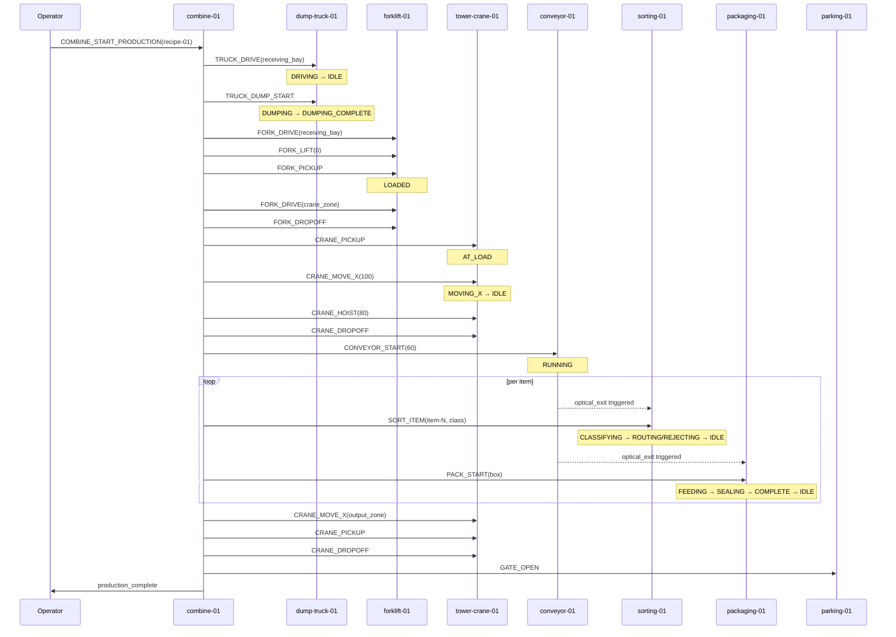

# Smart Factory — End-to-End Material Flow Sequence

**Owner:** physical layer governance (Issues #9, #174)  
**Purpose:** Canonical material flow from raw input to packaged output, tracing every stage through all 9 modules. Documents normal flow, degraded modes, and emergency procedures.  
**Status:** Design-only. All hardware is **BLOCKED-L3** (Issue #98).  

---

## 1. Factory Topology

```
Dump Truck (inbound)
        │
        ▼
Forklift (receiving bay)
        │
        ▼
Tower Crane ── Parking Lot (logistics staging)
        │
        ▼
Conveyor Belt ── Sorting Machine
        │
        ▼
Packaging Machine
        │
        ▼
Tower Crane (output)
        │
        ▼
Parking Lot (output staging) ── Forklift (outbound)
```

**Brackets (`brackets-01`)** are distributed along the conveyor path as structural mounts; they appear as `structural_health` indicators in telemetry, not as flow steps.

---

## 2. Canonical Production Flow (Happy Path)

### 2.1 Stage 0 — Factory Start-Up

```
[Operator] ──[manual inspection]──▶ all modules report IDLE
                                   all E-stop loops confirmed CLOSED
                                   all sensors report NOMINAL
                                   combine-01.state = IDLE
```

**Prerequisites before production:**
1. All 8 physical modules powered on and reporting `IDLE`.
2. All E-stop loops verified CLOSED.
3. No active faults on any module.
4. Parking Lot has available slots for inbound/outbound vehicles.
5. Conveyor belt cleared (no material on belt).

---

### 2.2 Stage 1 — Inbound Material Delivery

```
dump-truck-01.IDLE
        │
        ▼
dump-truck-01 ← [TRUCK_DRIVE(50, 10)] ── DRIVING
        │
        ▼ (arrives at receiving bay)
dump-truck-01.IDLE ← [TRUCK_DUMP_START]
        │
        ▼
dump-truck-01.DUMPING ──▶ dump-truck-01.DUMPING_COMPLETE (max angle sensor)
        │
        ▼
forklift-01 ← [FORK_DRIVE(50, 5)] ── DRIVING
        │
        ▼ (arrives at receiving bay)
forklift-01.IDLE ← [FORK_LIFT(0)] ── LIFTING
        │
        ▼ (fork at dump level)
forklift-01 ← [FORK_PICKUP]
        │
        ▼ (load confirmed)
forklift-01.LOADED
```

**Failure modes (Stage 1):**
- `TRUCK_DUMP_START` rejected if load cell below minimum (no material to dump) → operator notified.
- `FORK_PICKUP` rejected if load already present on fork.
- Obstacle detected by Forklift IR → `forklift-01.STOPPED`, path must clear before retry.

---

### 2.3 Stage 2 — Transport to Crane Pickup Zone

```
forklift-01 ← [FORK_DRIVE(40, 30)] ── DRIVING
        │
        ▼ (arrives at crane receiving zone)
forklift-01.IDLE ← [FORK_LIFT(150)] ── LIFTING ──▶ LIFTED (height reached)
        │
        ▼
forklift-01 ← [FORK_DROPOFF] ── UNLOADED (load placed on pallet stand)
        │
        ▼
tower-crane-01.IDLE ← [CRANE_PICKUP] ── AT_LOAD (load confirmed)
        │
        ▼
forklift-01 ← [FORK_DRIVE(parking_zone)]
tower-crane-01 ← [CRANE_MOVE_X(100)] ── MOVING_X
        │
        ▼ (X target reached)
tower-crane-01.IDLE ← [CRANE_HOIST(80)] ── HOISTING
        │
        ▼
forklift-01 ← [FORK_DRIVE(back_to_staging)]
parking-01 ← [GATE_OPEN] (if Forklift enters parking)
```

**Zone safety:** Tower Crane must hold a zone-clear confirmation from Forklift before initiating `CRANE_MOVE_X`. Zone clearance is a handshake signal, not a timer.

**Failure modes (Stage 2):**
- Limit switch during `CRANE_MOVE_X` → `tower-crane-01.E_STOP`.
- Overload during `CRANE_HOIST` (load cell > threshold) → `E_STOP`.
- Forklift obstacle during `FORK_DRIVE` → `forklift-01.STOPPED`.

---

### 2.4 Stage 3 — Conveyor Feed

```
conveyor-01.IDLE
        │
        ▼
conveyor-01 ← [CONVEYOR_START(60)] ── STARTING ──▶ RUNNING (speed=60)
        │
        ▼
tower-crane-01 ← [CRANE_DROPOFF] ── AT_DROP
        │
        ▼ (load released onto conveyor entry)
conveyor-01 ← [CONVEYOR_STOP] ── STOPPING ──▶ STOPPED
        │
        ▼ (brief stop to load, prevents jam)
conveyor-01 ← [CONVEYOR_START(60)] ── RUNNING
        │
        ▼ (item moves toward sorting)
conveyor-01.optical_entry = true (entry sensor triggered)
conveyor-01.optical_entry = false
```

**Failure modes (Stage 3):**
- `CONVEYOR_START` rejected if jam sensor active → clear jam first.
- Jam sensor triggers during `RUNNING` → `conveyor-01.E_STOP`, operator must clear.

---

### 2.5 Stage 4 — Sorting and Classification

```
sorting-01.IDLE
        │
        ▼
conveyor-01.optical_exit = true ──▶ sorting-01 ← [SORT_ITEM(item-001, METAL)]
        │
        ▼
sorting-01 ← CLASSIFYING
        │
        ▼ (inductive sensor detects METAL)
sorting-01 ← ROUTING (diverter to −45°, target: BIN_1)
        │
        ▼ (item diverted to BIN_1)
sorting-01 ← IDLE
        │
        ▼ (next item arrives)
sorting-01 ← [SORT_ITEM(item-002, PLASTIC)] ── CLASSIFYING
        │
        ▼ (color code = 1)
sorting-01 ← ROUTING (diverter 0°, target: BIN_2)
        │
        ▼
sorting-01.IDLE
        │
        ▼
sorting-01 ← [SORT_ITEM(item-003, UNKNOWN)] ── CLASSIFYING
        │
        ▼ (no matching sensor pattern)
sorting-01 ← REJECTING (diverter +90°, target: REJECT_LANE)
        │
        ▼
sorting-01.IDLE
```

**Sorting decision rules (deterministic):**

| item_class | Trigger | Diverter Angle | Destination |
|-----------|---------|---------------|-------------|
| `METAL` | Inductive sensor HIGH | −45° | `BIN_1` |
| `PLASTIC` | Color code = 1 | 0° (straight) | `BIN_2` |
| `WOOD` | Color code = 2 | +45° | `BIN_3` |
| `DEFECTIVE` | Quality flag set | +90° | `REJECT_LANE` |
| `UNKNOWN` | No match | +90° | `REJECT_LANE` |

**Failure modes (Stage 4):**
- `SORT_JAM_SENSE` active → `sorting-01.E_STOP`.
- Sensor bus heartbeat loss → `sorting-01.FAULT`.
- `SORT_ITEM` during `E_STOP`/`FAULT` → `rejected`.

---

### 2.6 Stage 5 — Packaging

```
packaging-01.IDLE
        │
        ▼
conveyor-01.optical_exit = true (item enters packaging inlet)
        │
        ▼
packaging-01 ← [PACK_START(box)] ── FEEDING
        │
        ▼ (item at inlet sensor: PACK_OPT_INLET = true)
packaging-01 ← SEALING
        │
        ▼ (seal cycle complete, temperature/pressure within bounds)
packaging-01 ← COMPLETE
        │
        ▼ (item exits: PACK_OPT_OUTLET = true)
packaging-01 ← IDLE
        │
        ▼
conveyor-01 ← [CONVEYOR_STOP] (pipeline pauses)
```

**Failure modes (Stage 5):**
- `PACK_JAM_SENSE` → `packaging-01.E_STOP`.
- `PACK_TEMP_AI` out of range → `packaging-01.FAULT`.
- `PACK_PRESSURE_AI` below minimum → `packaging-01.FAULT`.

---

### 2.7 Stage 6 — Output Crane and Logistics

```
tower-crane-01.IDLE
        │
        ▼
tower-crane-01 ← [CRANE_MOVE_X(200)] ── MOVING_X (move to packaging output zone)
        │
        ▼ (X target reached)
tower-crane-01 ← [CRANE_HOIST(60)] ── HOISTING
        │
        ▼
tower-crane-01 ← [CRANE_PICKUP] ── AT_LOAD (package picked)
        │
        ▼
tower-crane-01 ← [CRANE_MOVE_X(300)] ── MOVING_X (output staging zone)
        │
        ▼
tower-crane-01 ← [CRANE_DROPOFF] ── AT_DROP (package placed)
        │
        ▼
parking-01 ← [GATE_OPEN] (if outbound vehicle waiting)
        │
        ▼
forklift-01 ← [FORK_DRIVE(output_zone)] ── DRIVING
        │
        ▼
forklift-01 ← [FORK_PICKUP] ── LOADED
        │
        ▼
forklift-01 ← [FORK_DRIVE(exit_zone)] ── DRIVING
        │
        ▼
parking-01 ← [GATE_OPEN]
        │
        ▼
forklift-01 ← [FORK_DRIVE(exit)] ── DRIVING ──▶ dump-truck-01 (loading for outbound)
```

---

### 2.8 Stage 7 — Factory Shutdown

```
[Operator] ← [CONBINE_STOP] ── drain pipeline
        │
        ▼ (all in-flight items reach terminal stations)
combine-01 ← DRAINING ──▶ IDLE
        │
        ▼
conveyor-01 ← [CONVEYOR_STOP] ── STOPPED
sorting-01 ← [SORTING_STOP] ── STOPPED
packaging-01 ← [PACK_STOP] ── IDLE
tower-crane-01 ← [CRANE_STOP] ── IDLE
        │
        ▼
[Operator] performs post-run inspection
[Operator] acknowledges all module states = IDLE
```

---

## 3. Emergency Stop Sequence

Any `E_STOP` condition propagates through the combine pipeline as follows:

```
[any module E_STOP] ──▶ combine-01 ← SAFETY_HALT
                              │
                              ├── conveyor-01 ← E_STOP (via estop relay chain)
                              ├── sorting-01 ← E_STOP
                              ├── packaging-01 ← E_STOP
                              └── tower-crane-01 ← E_STOP
                                          │
                                          ▼
                              [Operator physically releases E-stop button]
                                          │
                                          ▼
                              [all jam sensors clear]
                                          │
                                          ▼
                              [per-module RESET commands issued]
                                          │
                                          ▼
                              all modules ← IDLE
                              combine-01 ← IDLE
```

**Physical E-stop reset authority:** Only on-site operator. Network command cannot reset a physical hardware E-stop.

---

## 4. Degraded Mode Handling

### 4.1 Missing Module — Tower Crane Unavailable

If `tower-crane-01` is in `FAULT` or `E_STOP`:

```
forklift-01 assumes transport role
forklift-01 ← [FORK_DRIVE(conv_entry)] ── DRIVING
forklift-01 ← [FORK_LIFT(receiving_height)]
forklift-01 ← [FORK_DROPOFF]
conveyor-01 ← [CONVEYOR_START(60)] ── RUNNING
combine-01 ← [COMBINE_START_PRODUCTION] ── DEGRADED_MODE
```

Production continues without crane-assisted lift/place. Throughput is reduced.

### 4.2 Parking Lot Full

```
parking-01 ← GATE_OPEN rejected
status: NO_SLOT_AVAILABLE
combine-01 notified
forklift-01 ← [FORK_DRIVE(waiting_zone)] ── DRIVING
operator resolves parking
```

### 4.3 Sorting Machine Fault

```
sorting-01 ← FAULT
conveyor-01 ← [CONVEYOR_STOP] ── STOPPED (upstream stops)
combine-01 ← SAFETY_HALT
operator resolves fault
sorting-01 ← [RESET]
sorting-01 ← IDLE
conveyor-01 ← [CONVEYOR_START]
combine-01 ← [COMBINE_START_PRODUCTION]
```

---

## 5. Timing and Throughput Assumptions (L2 Simulation Reference)

> ⚠️ These are simulation reference values for adapter testing only. No physical measurement has been made.

| Stage | Operation | Simulated Duration |
|-------|-----------|-------------------|
| S1 | Dump truck drive | 5 s |
| S1 | Dump and forklift pickup | 10 s |
| S2 | Forklift drive to crane zone | 8 s |
| S2 | Crane lift and move | 6 s |
| S3 | Conveyor feed per item | 3 s |
| S4 | Sort and route per item | 4 s |
| S5 | Package per item | 8 s |
| S6 | Crane output and logistics | 12 s |
| **Total** | **End-to-end per item** | **~56 s** |

---

## 6. Command Sequence Diagram (Mermaid)



---

## 7. Test Cases (per Issue #9 TC1–TC5)

| TC | Description | Expected | Verification |
|----|-----------|----------|-------------|
| TC1 | Nine-module inventory validated | All 9 modules documented with typed IO | L0 spec review |
| TC2 | Normal production sequence simulated | End-to-end flow completes without error | L2 adapter simulation |
| TC3 | Missing module produces degraded/blocked | Tower Crane `FAULT` → degrade to forklift-only | L2 adapter simulation |
| TC4 | Emergency stop halts affected components | Any `E_STOP` → `combine-01.SAFETY_HALT` | L2 adapter simulation |
| TC5 | Physical mapping matches digital IDs | `device_id` in telemetry matches canonical mapping | L1 unit test |
