# End-to-End Material Flow Sequence

**Status:** Proposed design contract (L0 only).
**Issue:** #9 (parent: `contracts/physical/factory-interface.md`, §11 cross-module invariants)
**Owner:** Physical-layer governance
**Sources:** `contracts/physical/factory-interface.md` (4158d3ae), `contracts/gateway/canonical-flows.md`, `docs/adr/adr-0006-local-physical-safety.md`, `docs/integration-matrix.md`
**Evidence level:** L0 — static design contract. Physical module interconnection is L3/L4-gated by Issue #98.

---

## 1. Overview

This document traces the canonical physical path of a single material unit through all nine factory modules, from raw-material delivery by the **Dump Truck** to the packaged unit staged in the **Parking** lot. It annotates every step with the module, action, triggers, outputs, FSM state transitions, decision points, safety interlock activations, and inter-module timing dependencies.

**Source contracts relied upon:**
- `contracts/physical/factory-interface.md` — per-module FSM diagrams, logical I/O, command contracts, telemetry shapes.
- `contracts/gateway/canonical-flows.md` — MQTT command dispatch (Flow 2), telemetry ingestion (Flow 1), and the Combine coordinator's aggregate state model.
- `docs/adr/adr-0006-local-physical-safety.md` — four-layer safety enforcement; fail-closed by design.
- `docs/integration-matrix.md` — evidence-level taxonomy; all physical module I/O is L3/L4-blocked by Issue #98.

**Modules in canonical order** (production recipe driven by **Combine**):

| # | Module | Canonical Role in Flow |
|---|--------|------------------------|
| 1 | Dump Truck | Raw-material delivery to intake zone |
| 2 | Forklift | Pallet / unit transfer from intake to conveyor entry |
| 3 | Conveyor | Continuous feed into sorting station |
| 4 | Sorting | Classification and lane routing |
| 5 | Tower Crane | Inter-station lift and place (sorting → packaging) |
| 6 | Packaging | Seal and package the routed unit |
| 7 | Forklift | Transport packaged unit to staging |
| 8 | Parking | Staged output / vehicle bay management |
| 9 | Combine | Production orchestrator — holds recipe state, watches member health |

Brackets provide structural support only and do not participate in the material path.

---

## 2. Canonical Production Recipe

A single **recipe** (`recipeId`) defines which material classes and sorting routes are active for one production run. The Combine module (device `combine-01`) is the sole orchestrator; it observes member states and issues per-module commands only when safety and readiness preconditions are satisfied.

```text
COMBINE_START_PRODUCTION(recipeId)
  └─► Dump Truck     → delivers to intake zone
  └─► Forklift       → loads unit onto conveyor entry
  └─► Conveyor       → feeds unit toward sorting
  └─► Sorting        → classifies → routes (lane A: packaging, lane B: reject)
  ├─► [lane A path]
  │     └─► Tower Crane → lifts from sort-out → places at packaging infeed
  │     └─► Packaging    → seals unit
  │     └─► Forklift     → transports to parking staging
  │     └─► Parking      → stages output unit
  └─► [lane B path — reject]
        └─► Tower Crane → lifts to reject bin (no further steps)

COMBINE_STOP
  └─► Conveyor       → drain
  └─► Sorting        → drain
  └─► Packaging      → complete current cycle or abort
  └─► Parking        → allow vehicle departure
```

---

## 3. Sequence Diagram

```mermaid
sequenceDiagram
    autonumber
    participant COMB as Combine<br/>(combine-01)
    participant DT as Dump Truck<br/>(dump-truck-01)
    participant FL1 as Forklift<br/>(forklift-01)
    participant CONV as Conveyor<br/>(conveyor-01)
    participant SORT as Sorting<br/>(sorting-01)
    participant CRANE as Tower Crane<br/>(tower-crane-01)
    participant PACK as Packaging<br/>(packaging-01)
    participant FL2 as Forklift<br/>(forklift-01)
    participant PARK as Parking<br/>(parking-01)
    participant GW as IoT Gateway

    Note over COMB: IDLE — recipe loaded

    rect rgb(240,248,255)
        Note over COMB,DT: PHASE 1 — Raw Material Intake
        COMB->>DT: TRUCK_DRIVE(intake_x, intake_y)
        DT->>DT: IDLE → DRIVING
        DT->>GW: telemetry: state=DRIVING, sensors.frontObstacle=false
        DT->>DT: DRIVING → IDLE (target reached)
        DT->>GW: telemetry: state=IDLE, sensors.loadGrams=500
        COMB->>DT: TRUCK_DUMP_START()
        DT->>DT: IDLE → DUMPING
        DT->>GW: telemetry: state=DUMPING, sensors.dumpAngleDeg=32
        DT->>DT: DUMPING → DUMP_COMPLETE
        DT->>GW: telemetry: state=DUMP_COMPLETE, sensors.loadGrams=0
        COMB->>DT: TRUCK_DUMP_LOWER()
        DT->>DT: DUMP_COMPLETE → IDLE
        DT->>GW: telemetry: state=IDLE
    end

    rect rgb(255,250,240)
        Note over COMB,FL1: PHASE 2 — Forklift Transfer
        COMB->>FL1: FORK_DRIVE(intake_x, intake_y)
        FL1->>FL1: IDLE → DRIVING
        FL1->>GW: telemetry: state=DRIVING
        FL1->>FL1: DRIVING → IDLE
        FL1->>GW: telemetry: state=IDLE
        COMB->>FL1: FORK_PICKUP()
        FL1->>FL1: IDLE → LIFTING
        FL1->>GW: telemetry: state=LIFTING, sensors.liftHigh=false
        FL1->>FL1: LIFTING → IDLE (load confirmed)
        FL1->>GW: telemetry: state=IDLE, progress.forkHeightMm=80
        COMB->>FL1: FORK_DRIVE(conveyor_entry_x, conveyor_entry_y)
        FL1->>FL1: IDLE → DRIVING
        FL1->>GW: telemetry: state=DRIVING
        FL1->>FL1: DRIVING → IDLE
        COMB->>FL1: FORK_DROPOFF()
        FL1->>FL1: IDLE → LIFTING
        FL1->>GW: telemetry: state=LIFTING
        FL1->>FL1: LIFTING → IDLE (load released)
    end

    rect rgb(240,255,240)
        Note over COMB,CONV: PHASE 3 — Conveyor Feed
        COMB->>CONV: CONVEYOR_START(speedMmPerSec=50)
        CONV->>CONV: IDLE → STARTING
        CONV->>GW: telemetry: state=STARTING
        CONV->>CONV: STARTING → RUNNING (motion feedback)
        CONV->>GW: telemetry: state=RUNNING, progress.speedMmPerSec=50
        CONV->>CONV: CONV_ENTRY sensor detects material
        CONV->>GW: telemetry: sensors.entry=true
        CONV->>CONV: material traverses belt
        CONV->>CONV: CONV_EXIT sensor detects material (→ sorting inlet)
        CONV->>GW: telemetry: sensors.exit=true
        COMB->>CONV: CONVEYOR_STOP()
        CONV->>CONV: RUNNING → STOPPING
        CONV->>CONV: STOPPING → IDLE (zero speed)
        CONV->>GW: telemetry: state=IDLE
    end

    rect rgb(255,245,238)
        Note over COMB,SORT: PHASE 4 — Sorting & Routing
        Note over SORT: SORT_INLET detects material
        SORT->>GW: telemetry: sensors.inlet=true, state=CLASSIFYING
        SORT->>SORT: classify (AI: SORT_CLASS or default route)
        alt material class = "A" (packaging lane)
            SORT->>SORT: ROUTING — set SORT_DIVERTER to BIN_1
            SORT->>GW: telemetry: state=ROUTING, progress.destination=BIN_1
            SORT->>SORT: route confirmed → IDLE
        else material class = "B" (reject lane)
            SORT->>SORT: REJECTING — set SORT_DIVERTER to REJECT
            SORT->>GW: telemetry: state=REJECTING, progress.destination=REJECT
            SORT->>SORT: reject confirmed → IDLE
        end
        SORT->>GW: telemetry: state=IDLE, activeFaults=[]
    end

    alt lane A: packaging path
        rect rgb(255,250,250)
            Note over COMB,CRANE: PHASE 5A — Tower Crane Lift & Place
            COMB->>CRANE: CRANE_MOVE_X(targetMm=sorting_out_x)
            CRANE->>CRANE: IDLE → MOVING_X
            CRANE->>GW: telemetry: state=MOVING_X, progress.xMm=150
            CRANE->>CRANE: MOVING_X → IDLE (target / limit reached)
            COMB->>CRANE: CRANE_HOIST(targetMm=80)
            CRANE->>CRANE: IDLE → HOISTING
            CRANE->>GW: telemetry: state=HOISTING, progress.zMm=80
            COMB->>CRANE: CRANE_PICKUP()
            CRANE->>CRANE: IDLE → PICKING
            CRANE->>GW: telemetry: state=PICKING, sensors.loadGrams>0
            CRANE->>CRANE: PICKING → IDLE (load confirmed)
            COMB->>CRANE: CRANE_MOVE_X(targetMm=packaging_in_x)
            CRANE->>CRANE: IDLE → MOVING_X
            CRANE->>GW: telemetry: state=MOVING_X
            CRANE->>CRANE: MOVING_X → IDLE
            COMB->>CRANE: CRANE_HOIST(targetMm=packaging_in_z)
            CRANE->>CRANE: IDLE → HOISTING
            COMB->>CRANE: CRANE_DROPOFF()
            CRANE->>CRANE: HOISTING → IDLE (drop confirmed)
            CRANE->>GW: telemetry: state=IDLE
        end

        rect rgb(255,248,255)
            Note over COMB,PACK: PHASE 6 — Packaging
            COMB->>PACK: PACK_START(packageType=box)
            PACK->>PACK: IDLE → FEEDING
            PACK->>GW: telemetry: state=FEEDING, sensors.inlet=true
            PACK->>PACK: FEEDING → SEALING (inlet detected)
            PACK->>GW: telemetry: state=SEALING, sensors.temperatureC=170
            PACK->>PACK: SEALING → COMPLETE (seal confirmed)
            PACK->>GW: telemetry: state=COMPLETE, progress.cycleCount=1
            PACK->>PACK: COMPLETE → IDLE (outlet cleared)
            PACK->>GW: telemetry: state=IDLE
        end

        rect rgb(240,248,255)
            Note over COMB,FL2: PHASE 7 — Forklift Staging (FL2 = same vehicle, new mission)
            COMB->>FL2: FORK_DRIVE(packaging_out_x, packaging_out_y)
            FL2->>FL2: IDLE → DRIVING
            FL2->>GW: telemetry: state=DRIVING
            FL2->>FL2: DRIVING → IDLE
            COMB->>FL2: FORK_PICKUP()
            FL2->>FL2: IDLE → LIFTING → IDLE
            FL2->>GW: telemetry: state=IDLE, progress.forkHeightMm=80
            COMB->>FL2: FORK_DRIVE(parking_slot_x, parking_slot_y)
            FL2->>FL2: IDLE → DRIVING → IDLE
            FL2->>GW: telemetry: state=DRIVING
            FL2->>FL2: DRIVING → IDLE
            COMB->>FL2: FORK_DROPOFF()
            FL2->>FL2: IDLE → LIFTING → IDLE
            FL2->>GW: telemetry: state=IDLE
        end

        rect rgb(230,230,250)
            Note over COMB,PARK: PHASE 8 — Parking Staging
            COMB->>PARK: GATE_OPEN()
            PARKing->>PARKing: IDLE → OPENING
            PARK->>GW: telemetry: state=OPENING, progress.availableSlots=N-1
            PARKing->>PARKing: OPENING → IDLE (open feedback)
            PARK->>GW: telemetry: state=IDLE, sensors.gateClear=true
            Note over PARK: vehicle drives through gate
            COMB->>PARK: GATE_CLOSE()
            PARKing->>PARKing: IDLE → CLOSING
            PARK->>GW: telemetry: state=CLOSING
            PARKing->>PARKing: CLOSING → IDLE (closed feedback)
            PARK->>GW: telemetry: state=IDLE, sensors.slotN=true
        end
    else lane B: reject path
        rect rgb(255,240,240)
            Note over COMB,CRANE: PHASE 5B — Tower Crane → Reject Bin
            COMB->>CRANE: CRANE_MOVE_X(reject_bin_x)
            CRANE->>CRANE: IDLE → MOVING_X → IDLE
            CRANE->>GW: telemetry: state=MOVING_X
            COMB->>CRANE: CRANE_HOIST(reject_bin_z)
            CRANE->>CRANE: IDLE → HOISTING → IDLE
            COMB->>CRANE: CRANE_DROPOFF()
            CRANE->>CRANE: IDLE → IDLE (drop confirmed)
            CRANE->>GW: telemetry: state=IDLE
        end
    end

    Note over COMB: PRODUCTION_RUNNING — all active members IDLE
    COMB->>GW: telemetry: state=PRODUCTION_RUNNING, progress.completedUnits=1
```



---

## 4. Per-Step Annotation

Each step records: module, device ID, action, FSM state entered, input triggers (sensor events or upstream commands), output produced (telemetry frame or inter-module signal), and the relevant I/O channels from `factory-interface.md`.

### Phase 1 — Raw Material Intake

#### Step 1 — Dump Truck Drive to Intake

| Field | Value |
|-------|-------|
| **Module** | Dump Truck |
| **device_id** | `dump-truck-01` |
| **Command issued** | `TRUCK_DRIVE(xTarget=intake_x, yTarget=intake_y)` |
| **FSM entered** | `DRIVING` |
| **Input triggers** | `TRUCK_FRONT_OBSTACLE=clear`, `TRUCK_REAR_OBSTACLE=clear` (DI) |
| **Output produced** | Telemetry: `{state:"DRIVING", sensors:{frontObstacle:false, rearObstacle:false}}` |
| **I/O channels** | `TRUCK_DRIVE` (MOTOR), `TRUCK_FRONT_OBSTACLE` / `TRUCK_REAR_OBSTACLE` (DI) |
| **Terminal state** | `IDLE` — reached target; `sensors.loadGrams=500` (AI) |

#### Step 2 — Dump

| Field | Value |
|-------|-------|
| **Command issued** | `TRUCK_DUMP_START()` |
| **FSM entered** | `DUMPING` |
| **Input triggers** | `TRUCK_DUMP_ANGLE` AI reports approaching target angle |
| **Output produced** | Telemetry: `{state:"DUMPING", sensors:{dumpAngleDeg:32, loadGrams:500}}` |
| **I/O channels** | `TRUCK_DUMP` (MOTOR), `TRUCK_DUMP_ANGLE` (AI) |
| **Terminal state** | `DUMP_COMPLETE` — target angle reached |
| **Next** | `TRUCK_DUMP_LOWER()` → `IDLE` |

---

### Phase 2 — Forklift Transfer

#### Step 3 — Forklift Drive to Intake

| Field | Value |
|-------|-------|
| **Module** | Forklift |
| **device_id** | `forklift-01` |
| **Command issued** | `FORK_DRIVE(xTarget=intake_x, yTarget=intake_y)` |
| **FSM entered** | `DRIVING` |
| **Input triggers** | `FORK_FRONT_OBSTACLE=clear`, zone lock with crane (shared-zone protocol) |
| **Output produced** | Telemetry: `{state:"DRIVING", sensors:{frontObstacle:false, rearObstacle:false}}` |
| **I/O channels** | `FORK_DRIVE` (MOTOR), `FORK_STEER` (SERVO), obstacle DI channels |
| **Terminal state** | `IDLE` |

#### Step 4 — Forklift Pick Up

| Field | Value |
|-------|-------|
| **Command issued** | `FORK_PICKUP()` |
| **FSM entered** | `LIFTING` |
| **Input triggers** | `FORK_LIFT_LOW=clear` (DI) |
| **Output produced** | Telemetry: `{state:"LIFTING", sensors:{liftHigh:false}}` → `{state:"IDLE", progress:{forkHeightMm:80}}` |
| **I/O channels** | `FORK_LIFT` (MOTOR), `FORK_LIFT_LOW` / `FORK_LIFT_HIGH` (DI) |
| **Terminal state** | `IDLE` — load confirmed |

#### Step 5 — Forklift Deliver to Conveyor Entry

| Field | Value |
|-------|-------|
| **Command issued** | `FORK_DRIVE(xTarget=conveyor_entry_x, yTarget=conveyor_entry_y)` |
| **FSM entered** | `DRIVING` |
| **Output produced** | Telemetry: `{state:"DRIVING"}` → `{state:"IDLE"}` |
| **Terminal state** | `IDLE` |
| **Next** | `FORK_DROPOFF()` → `IDLE`, unit placed at `CONV_ENTRY` sensor |

---

### Phase 3 — Conveyor Feed

#### Step 6 — Conveyor Start and Material Traverse

| Field | Value |
|-------|-------|
| **Module** | Conveyor |
| **device_id** | `conveyor-01` |
| **Command issued** | `CONVEYOR_START(speedMmPerSec=50)` |
| **FSM entered** | `STARTING` → `RUNNING` |
| **Input triggers** | Motion feedback from encoder; `CONV_MOTOR_TEMP` AI within bounds |
| **Output produced** | Telemetry: `{state:"STARTING"}` → `{state:"RUNNING", progress:{speedMmPerSec:50}}` |
| **I/O channels** | `CONV_MOTOR` (MOTOR), `CONV_ENTRY` / `CONV_EXIT` (DI), `CONV_MOTOR_TEMP` (AI), `CONV_ESTOP` (ESTOP) |
| **Decision gate** | Unit must trigger `CONV_ENTRY` within T_CONV_ENTRY_TIMEOUT ms; if not, jam assumed |
| **Terminal state** | `RUNNING` — material passes to Sorting via `CONV_EXIT` sensor event |
| **Next** | `CONVEYOR_STOP()` → `STOPPING` → `IDLE` |

---

### Phase 4 — Sorting and Routing

#### Step 7 — Inlet Detection and Classification

| Field | Value |
|-------|-------|
| **Module** | Sorting |
| **device_id** | `sorting-01` |
| **Command issued** | `SORT_ITEM(itemId, itemClass)` (implicit on `SORT_INLET=active`) |
| **FSM entered** | `CLASSIFYING` |
| **Input triggers** | `SORT_INLET=active` (DI); optional `SORT_CLASS` AI (color/vision signal) |
| **Output produced** | Telemetry: `{state:"CLASSIFYING", sensors:{inlet:true}}` |
| **I/O channels** | `SORT_INLET` / `SORT_METAL` / `SORT_JAM` (DI), `SORT_CLASS` (AI), `SORT_DIVERTER` (SERVO), `SORT_ESTOP` (ESTOP) |
| **Decision gate 1 — Classification** | If `SORT_CLASS` AI returns valid class → `ROUTING`; else → `REJECTING` |
| **Terminal state** | `IDLE` after diverter confirmed at destination |

#### Step 8A — Route to Packaging (class A)

| Field | Value |
|-------|-------|
| **Command issued** | (implicit after CLASSIFYING) `SORT_DIVERTER=degrees_to_BIN_1` |
| **FSM entered** | `ROUTING` |
| **Input triggers** | Diverter servo reaches target angle; `SORT_JAM=clear` (DI) |
| **Output produced** | Telemetry: `{state:"ROUTING", progress:{itemId, destination:"BIN_1"}}` |
| **Decision gate 2 — Jam** | If `SORT_JAM=active` → `E_STOP`; reject is safe even in jam |
| **Terminal state** | `IDLE` |

#### Step 8B — Route to Reject (class B)

| Field | Value |
|-------|-------|
| **Command issued** | (implicit after CLASSIFYING) `SORT_DIVERTER=degrees_to_REJECT` |
| **FSM entered** | `REJECTING` |
| **Output produced** | Telemetry: `{state:"REJECTING", progress:{itemId, destination:"REJECT"}}` |
| **Terminal state** | `IDLE` |

---

### Phase 5A — Tower Crane: Packaging Path

#### Step 9 — Crane Move to Sorting Outfeed

| Field | Value |
|-------|-------|
| **Module** | Tower Crane |
| **device_id** | `tower-crane-01` |
| **Command issued** | `CRANE_MOVE_X(targetMm=sorting_out_x)` |
| **FSM entered** | `MOVING_X` |
| **Input triggers** | `CRANE_X_MIN` / `CRANE_X_MAX` limit DI; `CRANE_X_ENCODER` (ENC) position feedback |
| **Output produced** | Telemetry: `{state:"MOVING_X", progress:{xMm:150}}` |
| **I/O channels** | `CRANE_TROLLEY` (STEP), `CRANE_X_ENCODER` (ENC), `CRANE_X_MIN` / `CRANE_X_MAX` (DI), `CRANE_ESTOP` (ESTOP) |
| **Interlock** | Zone lock: crane cannot move while forklift occupies shared corridor |
| **Terminal state** | `IDLE` — target X reached or limit reached |

#### Step 10 — Crane Hoist and Pick Up

| Field | Value |
|-------|-------|
| **Command issued** | `CRANE_HOIST(targetMm=80)` |
| **FSM entered** | `HOISTING` |
| **Input triggers** | `CRANE_Z_LOW` / `CRANE_Z_HIGH` DI; `CRANE_LOAD` AI (overload guard) |
| **Output produced** | Telemetry: `{state:"HOISTING", progress:{zMm:80}}` |
| **Next** | `CRANE_PICKUP()` → `PICKING` → `IDLE` (load confirmed, `sensors.loadGrams>0`) |

#### Step 11 — Crane Deliver to Packaging Infeed

| Field | Value |
|-------|-------|
| **Command issued** | `CRANE_MOVE_X(targetMm=packaging_in_x)` → `CRANE_HOIST(targetMm=packaging_in_z)` → `CRANE_DROPOFF()` |
| **FSM entered** | `MOVING_X` → `HOISTING` → `IDLE` |
| **Output produced** | Telemetry: `{state:"IDLE", progress:{xMm, zMm}}` |
| **Interlock** | Overload (`CRANE_LOAD AI > limit`) → `E_STOP` on hoist; zone must remain clear |

---

### Phase 5B — Tower Crane: Reject Path

#### Step 9B — Crane Move to Reject Bin

| Field | Value |
|-------|-------|
| **Command issued** | `CRANE_MOVE_X(targetMm=reject_bin_x)` → `CRANE_HOIST(targetMm=reject_bin_z)` → `CRANE_DROPOFF()` |
| **FSM entered** | `MOVING_X` → `HOISTING` → `IDLE` |
| **Output produced** | Telemetry: `{state:"IDLE"}` — no further material flow |
| **No downstream module triggered** | End of path for reject units |

---

### Phase 6 — Packaging

#### Step 12 — Packaging Start and Seal

| Field | Value |
|-------|-------|
| **Module** | Packaging |
| **device_id** | `packaging-01` |
| **Command issued** | `PACK_START(packageType=box)` |
| **FSM entered** | `FEEDING` |
| **Input triggers** | `PACK_INLET=active` (DI); `PACK_TEMP` and `PACK_PRESSURE` AI within safe bounds |
| **Output produced** | Telemetry: `{state:"FEEDING", sensors:{inlet:true}}` |
| **I/O channels** | `PACK_INLET` / `PACK_OUTLET` / `PACK_JAM` (DI), `PACK_TEMP` / `PACK_PRESSURE` (AI), `PACK_FEED` (MOTOR), `PACK_SEAL` (SERVO/DO), `PACK_ESTOP` (ESTOP) |
| **Transition** | `PACK_INLET` detected → `SEALING` |
| **Decision gate** | If `PACK_TEMP < minSafeTemp` OR `PACK_PRESSURE < minSafePressure` → `FAULT` (latched) |
| **Seal complete** | `PACK_SEAL` confirmed → `COMPLETE` → outlet cleared → `IDLE` |
| **Output produced** | Telemetry: `{state:"SEALING", progress:{cycleCount:1}}` → `{state:"IDLE"}` |

---

### Phase 7 — Forklift Staging (packaging path only)

#### Step 13 — Forklift Transport to Parking

| Field | Value |
|-------|-------|
| **Module** | Forklift (same physical vehicle, second mission) |
| **device_id** | `forklift-01` |
| **Command sequence** | `FORK_DRIVE(packaging_out)` → `FORK_PICKUP()` → `FORK_DRIVE(parking_slot)` → `FORK_DROPOFF()` |
| **FSM sequence** | `DRIVING` → `IDLE` → `LIFTING` → `IDLE` → `DRIVING` → `IDLE` → `LIFTING` → `IDLE` |
| **Output produced** | Telemetry per segment: `{state, sensors, progress}` |
| **Zone lock** | Crane must confirm `IDLE` and corridor clear before forklift drives to parking |

---

### Phase 8 — Parking Staging

#### Step 14 — Gate Open and Vehicle Stage

| Field | Value |
|-------|-------|
| **Module** | Parking |
| **device_id** | `parking-01` |
| **Command issued** | `GATE_OPEN()` |
| **FSM entered** | `OPENING` |
| **Input triggers** | `PARK_SLOT_1..N` (DI) — at least one slot free |
| **Output produced** | Telemetry: `{state:"OPENING", progress:{availableSlots:N-1}}` |
| **I/O channels** | `PARK_SLOT_1..N` (DI), `PARK_GATE` (SERVO/DO), `PARK_GATE_CLEAR` (DI), `PARK_ESTOP` (ESTOP) |
| **Decision gate — Slot availability** | If all slots occupied → `BLOCKED`; await slot release before `GATE_OPEN` |
| **Terminal state** | `IDLE` — gate open, `sensors.gateClear=true` |
| **Next** | Vehicle drives through → `GATE_CLOSE()` → `CLOSING` → `IDLE`, `sensors.slotN=true` |

---

### Phase 9 — Combine Coordinator

#### Combine Production Run State

| Field | Value |
|-------|-------|
| **Module** | Combine |
| **device_id** | `combine-01` |
| **Recipe state** | `PRODUCTION_RUNNING` |
| **Input triggers** | All member modules report `IDLE` with fresh telemetry (within staleness threshold) |
| **Output produced** | Telemetry: `{state:"PRODUCTION_RUNNING", progress:{recipeId, completedUnits:1}}` |
| **Interlock** | Any member in `E_STOP` or `FAULT` → `SAFETY_HALT`; Combine cannot reset members |
| **Recovery** | `SAFETY_HALT` → each member cleared locally → `RESET` → all report `IDLE` → `IDLE` state |
| **Recipe complete** | All units delivered → `COMBINE_STOP()` → `DRAINING` → all `IDLE` → `IDLE` |

---

## 5. State Transition Summary

| Module | IDLE→ | Active state(s) | Terminal (success) | Terminal (fault) |
|--------|--------|-----------------|-------------------|-----------------|
| Dump Truck | DRIVING | DUMPING, DUMP_COMPLETE | IDLE | E_STOP |
| Forklift | DRIVING, LIFTING | — | IDLE | E_STOP (obstacle/overload) |
| Conveyor | STARTING | RUNNING, STOPPING | IDLE | E_STOP (jam/ESTOP), FAULT (thermal) |
| Sorting | CLASSIFYING | ROUTING, REJECTING | IDLE | E_STOP (jam/ESTOP), FAULT (sensor lost) |
| Tower Crane | MOVING_X, HOISTING | PICKING | IDLE | E_STOP (limit/overload/ESTOP), FAULT (encoder timeout) |
| Packaging | FEEDING | SEALING, COMPLETE | IDLE | E_STOP (jam/ESTOP), FAULT (thermal/pressure) |
| Parking | OPENING, CLOSING | BLOCKED | IDLE | E_STOP |
| Combine | PRODUCTION_RUNNING | DRAINING, SAFETY_HALT | IDLE | SAFETY_HALT |

---

## 6. Decision Points

| # | Decision | Module | Criteria | Outcome A | Outcome B |
|---|----------|--------|----------|----------|----------|
| D1 | Material classification | Sorting | `SORT_CLASS` AI signal | Valid class → `ROUTING` (lane A) | Unknown → `REJECTING` (lane B) |
| D2 | Conveyor entry timeout | Conveyor | `CONV_ENTRY` triggered within T_CONV_ENTRY_TIMEOUT ms | Yes → `RUNNING` | No → `E_STOP` (jam assumed) |
| D3 | Parking slot availability | Parking | ≥1 `PARK_SLOT_N=false` | Available → `OPENING` | Full → `BLOCKED` |
| D4 | Sorting jam | Sorting | `SORT_JAM=active` | Jam detected → `E_STOP` | Clear → proceed |
| D5 | Crane zone lock | Tower Crane | Shared-zone corridor clear (forklift not occupying) | Clear → `MOVING_X` allowed | Occupied → command rejected |
| D6 | Packaging thermal/pressure safety | Packaging | `PACK_TEMP` ≥ minSafeTemp AND `PACK_PRESSURE` ≥ minSafePressure | Safe → `SEALING` | Unsafe → `FAULT` (latched) |
| D7 | Combine member staleness | Combine | All members fresh (within 60 s) | Fresh → `PRODUCTION_RUNNING` | Any stale → `SAFETY_HALT` |

---

## 7. Safety Interlock Activations and Recovery Paths

Reference: `docs/adr/adr-0006-local-physical-safety.md` — four-layer enforcement.

### 7.1 Layer 1 — MQTT Broker ACL

| Interlock | Trigger | Enforcement | Recovery |
|-----------|---------|-------------|---------|
| Only authenticated service accounts publish to `command/down` | Unauthorized `device_id` in topic | MQTT broker ACL rejects | Operator authenticates; ACL reconfigured |

### 7.2 Layer 2 — ESP32 Bridge Validation

| Interlock | Trigger | Enforcement | Recovery |
|-----------|---------|-------------|---------|
| Unknown command name | Command not in validated enum | NAK, no UART dispatch | Send known command |
| Value out of range | e.g. `CONVEYOR_START` speed > max | NAK, no UART dispatch | Resend with valid argument |
| Duplicate command ID | `commandId` seen in 16-entry cache | Silently deduped, no re-execution | Use new `commandId` |
| Command expired | `expiresAt` in past at bridge receipt | Rejected, no UART dispatch | Resend with future `expiresAt` |

### 7.3 Layer 3 — Local Controller (Mega / module-level)

| Interlock | Trigger | Module | Enforcement | Recovery |
|-----------|---------|--------|-------------|---------|
| E-stop open | `*_ESTOP` input goes open | All | Hardware interrupt removes all actuator enables; FSM → `E_STOP` | Operator physically releases E-stop; `RESET` command |
| Jam detected | `*_JAM=active` DI | Conveyor, Sorting, Packaging | Motor disabled; FSM → `E_STOP` | Clear jam; `RESET` |
| Limit switch | `CRANE_X_MAX=true` etc. | Tower Crane, Forklift | Motion stopped at hard stop; FSM → `E_STOP` | Clear path; `RESET` |
| Overload | `CRANE_LOAD AI > limit` | Tower Crane | Hoist motion stopped; FSM → `E_STOP` | Remove excess load; `RESET` |
| Obstacle | `FORK_*_OBSTACLE=true` | Forklift | Drive motion stopped; FSM → `STOPPED` | Clear obstacle; new command |
| Thermal fault | `CONV_MOTOR_TEMP AI > threshold` | Conveyor | Watchdog trips; FSM → `FAULT` | Cool motor; `RESET` |
| Sensor heartbeat lost | Encoder/AI polling timeout | Sorting | FSM → `FAULT` | Repair sensor; `RESET` |
| Zone conflict | Crane + Forklift in shared corridor simultaneously | Crane + Forklift | Zone lock prevents crane move; command rejected | Forklift vacates corridor; retry crane command |
| Parking gate obstruction | `PARK_GATE_CLEAR=false` when `GATE_CLOSE` issued | Parking | Gate halts; FSM stays `CLOSING` | Clear obstruction; retry `GATE_CLOSE` |

### 7.4 Layer 4 — AI / Twin / Dashboard

| Interlock | Trigger | Enforcement | Recovery |
|-----------|---------|-------------|---------|
| AI-generated action | Skill not in approved bounded registry | `iot-gateway` safety gate | `403 Forbidden`; no MQTT publish | Operator approves via separate authenticated session |
| Twin actuator command | Any `device_id` via WebSocket | Twin is **read-only** | Command rejected | N/A — use dashboard authenticated session |
| Dashboard unsafe command | Command violates ADR-0006 bounds | Gateway safety gate | `403 Forbidden` | Engineer reviews and issues corrected command |

### 7.5 E-Stop Recovery Sequence

```
Physical E-stop pressed
  → Layer 3: all actuator enables removed locally (hardware interrupt)
  → All modules: FSM → E_STOP
  → Combine: FSM → SAFETY_HALT
  → Gateway: telemetry state=UNKNOWN (stale) — cannot infer safe state
  → Dashboard: alert raised (Flow 4, ADR-0013)
  → Operator: physically releases E-stop chain
  → Per-module: local fault clearance confirmed by sensor
  → Operator: issues RESUME / RESET command per module (through command dispatch Flow 2)
  → Combine: observes all members return to IDLE
  → Combine: FSM → IDLE
  → Production may resume
```

> **Critical invariant (ADR-0006 §Consequences):** Hardware-level E-stop works even if all software systems (MQTT, Gateway, Twin, AI) are offline. No MQTT, WebSocket, or AI command can override or release a physical E-stop.

---

## 8. Timing Constraints and Inter-Module Dependencies

All timing constraints below are **design-time upper bounds**; actual values must be validated at L3/L4.

| Constraint ID | From | To | Max latency | Trigger | Notes |
|---------------|------|----|-------------|---------|-------|
| T\_CONV\_ENTRY\_TIMEOUT | Material placed at entry | `CONV_ENTRY` sensor active | 5 000 ms | `FORK_DROPOFF` complete | Jam assumed if missed |
| T\_SORT\_INLET\_TIMEOUT | `CONV_EXIT` active | `SORT_INLET` active | 2 000 ms | Belt traverse | Sorting must be IDLE |
| T\_CRANE\_RESPONSE | `CRANE_MOVE_X` command issued | `MOVING_X` telemetry received | 1 000 ms | Sorting ROUTING confirmed | |
| T\_CRANE\_PICKUP\_CONFIRM | `CRANE_PICKUP` issued | Load confirmed telemetry | 3 000 ms | Diverter confirmed | |
| T\_PACK\_INFEDD\_TIMEOUT | `CRANE_DROPOFF` complete | `PACK_INLET` active | 5 000 ms | Crane IDLE | |
| T\_PACK\_SEAL\_COMPLETE | `PACK_START` issued | `COMPLETE` state | 30 000 ms (configurable) | Thermal/pressure within bounds | |
| T\_FL2\_STAGING\_READY | Packaging COMPLETE | Forklift at parking slot | 15 000 ms | | |
| T\_PARK\_GATE\_TIMEOUT | `GATE_OPEN` issued | Gate open feedback | 5 000 ms | | |
| T\_COMBINE\_STALENESS | Any member module | Combine marks SAFETY\_HALT | 60 000 ms | `telemetry.stale=true` on any member | Staleness threshold = 60 s |
| T\_COMMAND\_ACK | Command published (QoS 1) | ACK telemetry received | 15 000 ms (TTL default 10 s) | | ADR-0005 TTL |
| T\_DUMP\_COMPLETE | `TRUCK_DUMP_START` | `DUMP_COMPLETE` state | 20 000 ms | | |

### 8.1 Critical Path

```
T_DUMP_COMPLETE (20 s)
  + T_FL1_TRANSFER (est. 30 s — drive+pickup+drive+dropoff)
  + T_CONV_TRAVERSE (est. 15 s — belt crossing time)
  + T_SORT_CLASSIFY (est. 5 s)
  + [lane A path]
      + T_CRANE_PICK_PLACE (est. 20 s)
      + T_PACK_SEAL (up to 30 s)
      + T_FL2_STAGING (est. 15 s)
      + T_PARK_STAGE (est. 10 s)
  = ~125 s end-to-end per unit (upper bound, L3/L4 to validate)
```

### 8.2 Parallelism

The **sorting → packaging path** (lane A) is sequential per unit. Multiple units may be in-flight simultaneously across different phases:

- Unit N in Packaging while Unit N+1 is on Conveyor
- Combine tracks per-unit `itemId` and routes independently
- Parking manages up to N slots concurrently

---

## 9. Telemetry Shape Per Step

Every step produces a `PlannedModuleTelemetry` frame (`factory-interface.md` §1.4) via the gateway telemetry ingestion flow (canonical-flows.md Flow 1). Until the bridge wires AMLP `TEL` frames to MQTT, telemetry is simulated in the factory-control adapter layer.

| Step | device_id | state | Key sensors | activeFaults |
|------|-----------|-------|-------------|-------------|
| 1 | `dump-truck-01` | `DRIVING` | frontObstacle=false | [] |
| 2 | `dump-truck-01` | `DUMPING` | dumpAngleDeg=32, loadGrams=500 | [] |
| 3 | `forklift-01` | `DRIVING` | frontObstacle=false, rearObstacle=false | [] |
| 4 | `forklift-01` | `LIFTING` | liftHigh=false | [] |
| 6 | `conveyor-01` | `RUNNING` | entry=false, exit=true, jam=false | [] |
| 7 | `sorting-01` | `CLASSIFYING` | inlet=true, metal=false, jam=false | [] |
| 8A | `sorting-01` | `ROUTING` | jam=false | [] |
| 9 | `tower-crane-01` | `MOVING_X` | xMin=false, loadGrams>0 | [] |
| 12 | `packaging-01` | `SEALING` | inlet=true, temperatureC=170, pressureKpa=500 | [] |
| 13 | `forklift-01` | `DRIVING` | frontObstacle=false | [] |
| 14 | `parking-01` | `OPENING` | slot1=false, gateClear=false | [] |
| — | `combine-01` | `PRODUCTION_RUNNING` | membersReady=8, membersFaulted=0 | [] |

---

## 10. Cross-Module Invariant Checklist

Verified against `factory-interface.md` §11:

- [ ] **Local safety wins:** No command overrides E-stop, jam, thermal, or overload interlocks at any layer.
- [ ] **Observed completion:** Combine advances recipe only on fresh member telemetry (`stale=false`).
- [ ] **Zone lock:** Crane and Forklift do not move in shared corridor simultaneously.
- [ ] **Staleness surfaced as UNKNOWN:** Gateway marks telemetry stale after 60 s; consumers do not infer safe/running state.
- [ ] **Recovery:** After E-stop, each module reaches local safe state and reports `IDLE` before Combine resumes.
- [ ] **No unverified channel reuse:** Mobile modules (crane, forklift, truck) use distinct controller channels; confirmed in IO tables.

---

## 11. Verification Status

| Module pair | Interface contract | L0 static | L1/L2 software | L3 bench | L4 HIL |
|-------------|---------------------|:---------:|:---------------:|:--------:|:-------:|
| Dump Truck → Forklift | Intake zone handoff | ✅ | 🔒 | 🔒 | 🔒 |
| Forklift → Conveyor | Physical placement at entry | ✅ | 🔒 | 🔒 | 🔒 |
| Conveyor → Sorting | `CONV_EXIT` → `SORT_INLET` sensor | ✅ | 🔒 | 🔒 | 🔒 |
| Sorting → Tower Crane | `ROUTING` diverter confirmed | ✅ | 🔒 | 🔒 | 🔒 |
| Tower Crane → Packaging | `PACK_INLET` sensor | ✅ | 🔒 | 🔒 | 🔒 |
| Packaging → Forklift | Physical placement at out | ✅ | 🔒 | 🔒 | 🔒 |
| Forklift → Parking | Physical placement at slot | ✅ | 🔒 | 🔒 | 🔒 |
| All → Combine | Aggregate state observe | ✅ | 🔒 | 🔒 | 🔒 |
| Combine → All | Command dispatch (Flow 2) | ✅ | 🔒 | 🔒 | 🔒 |
| All → Gateway | Telemetry ingestion (Flow 1) | ✅ | ✅ L2 | 🔒 | 🔒 |

**Legend:** ✅ = defined in contract, 🔒 = hardware gate (Issue #98)

---

## 12. Change Log

| Date | Change |
|------|--------|
| 2026-10-20 | Initial document. Traces canonical material unit through all 9 modules. Grounded in `factory-interface.md` (4158d3ae), `canonical-flows.md`, and ADR-0006. L0 static design only. |
