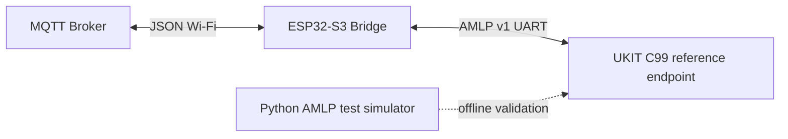
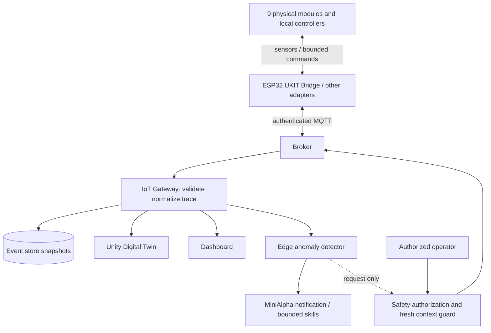

# Smart Factory — Architecture (baseline and target)

**This document deliberately separates implemented bridge behavior from the proposed integrated system.** The current engineering target uses **Unity 3D** and MiniAlpha. The original research proposal specified Unreal Engine; this is a historical reference and its formal amendment/approval status is unverified. Earlier material also mentioned Three.js and unimplemented MQTT topics, which are not implementation claims.

## Existing bridge baseline

Current documented firmware topics:
- Subscribe: `smart-factory/bridge/command`, JSON example `{"id":102,"fields":["CONVEYOR_START","60"]}`.
- Publish: `smart-factory/bridge/result` (queued, duplicate, invalid, acknowledged, failed and attempts), `smart-factory/bridge/status` (retained).
- AMLP v1 command/ACK/TEL frame shape and CRC are specified in `esp32-ukit-bridge/shared/protocol-spec/AMLP-v1.md`.
- Firmware currently lacks confirmed TEL-to-MQTT publish; reference UKIT is not approved physical controller firmware.
- Bridge ACK means a frame acknowledgement, **not** confirmed physical task completion.

## Proposed end-to-end architecture (not yet all implemented)

## Observation path
Device sensor state → local controller → bridge MQTT → gateway validated event → Twin, dashboard, AI, persisted event. The Twin must show **unknown/stale**, not invent a running state, when telemetry becomes disconnected or delayed.

## Action path
Operator/AI intent → role/capability authorization → current context and safety gate → expiry/idempotency checks → broker → local controller interlocks → protocol ACK → independent observed state/terminal feedback. Do not interpret `queued` or `acknowledged` as successful physical completion.

## Five conceptual layers
1. Physical factory and actuators
2. Industrial / IoT communication (UART AMLP, MQTT; OPC UA is a potential extension)
3. Edge / control (ESP32, local UKIT controllers, safe motion)
4. Data / AI (gateway, event store, anomalous conditions, robot adapter)
5. Applications (Unity Twin, dashboard, educational interfaces)

## Open architecture decisions

> ⚠️ The ADR backfill is in progress (Issue #81). Placeholder IDs below will be replaced with links to actual records.

- [ADR-0001](adr-0001-modular-monorepo.md): modular monorepo structure and module boundaries
- [ADR-0002](adr-0002-bridge-mqtt-amlp-contract.md): bridge MQTT ↔ AMLP contract and topic patterns
- [ADR-0003](adr-0003-digital-twin-engine.md): Digital Twin engine: Unity selected (institutional approval unverified)
- [ADR-0004](adr-0004-mega-sdk-boundary.md): Mega SDK boundary: portable C99 vs UBTEDU vendor SDK
- [ADR-0005](adr-0005-gateway-canonical-events.md): gateway canonical event envelope and normalization
- [ADR-0006](adr-0006-local-physical-safety.md): local physical command safety and AI fail-closed guard
- [ADR-0007](adr-0007-signed-ota-ab-rollback.md): signed HTTPS OTA with A/B rollback
- [ADR-0008](adr-0008-ota-manager-event-driven.md): event-driven OtaManager (no dedicated FreeRTOS task)
- [ADR-0009](adr-0009-telemetry-schema-compatibility.md): telemetry schema compatibility ⚠️ KNOWN MISMATCH
- ~~ADR-001~~: canonical system event schema and device IDs → see ADR-0005
- ~~ADR-002~~: Unreal engine version → see ADR-0003
- ~~ADR-003~~: per-device controller/voltage/SDK and E-stop → see ADR-0004 / ADR-0006
- ~~ADR-004~~: MiniAlpha API and skills → see Issue #13
- ~~ADR-005~~: latency thresholds → see Issue #43

See [component boundaries](components.md), [contracts](../contracts-and-data.md) and [acceptance](../testing-and-acceptance.md).
