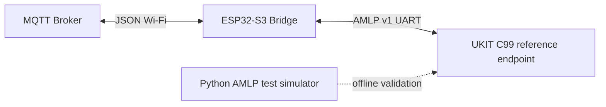
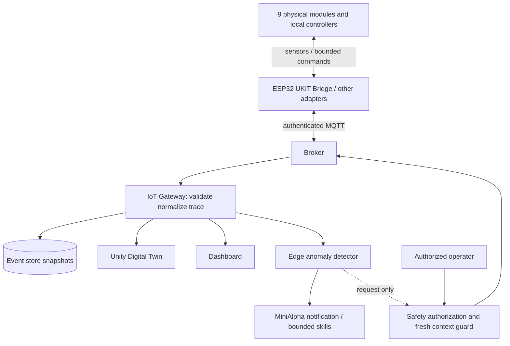

# Smart Factory — Architecture (baseline and target)

**This document deliberately separates implemented bridge behavior from the proposed integrated system.** The current engineering target uses **Unity 3D** and MiniAlpha. The original research proposal specified Unreal Engine; this is a historical reference and its formal amendment/approval status is unverified. Earlier material also mentioned Three.js and unimplemented MQTT topics, which are not implementation claims.

## Existing bridge baseline

Current documented firmware topics:
- Subscribe: `smart-factory/bridge/command`, JSON example `{"id":102,"fields":["CONVEYOR_START","60"]}`.
- Publish: `smart-factory/bridge/result` (queued, duplicate, invalid, acknowledged, failed and attempts), `smart-factory/bridge/status` (retained).
- AMLP v1 command/ACK/TEL frame shape and CRC are specified in `esp32-ukit-bridge/shared/protocol-spec/AMLP-v1.md`.
- Firmware currently lacks confirmed TEL-to-MQTT publish; reference UKIT is not approved physical controller firmware.
- Bridge ACK means a frame acknowledgement, **not** confirmed physical task completion.

## Proposed end-to-end architecture (not yet all implemented)

## Observation path
Device sensor state → local controller → bridge MQTT → gateway validated event → Twin, dashboard, AI, persisted event. The Twin must show **unknown/stale**, not invent a running state, when telemetry becomes disconnected or delayed.

## Action path
Operator/AI intent → role/capability authorization → current context and safety gate → expiry/idempotency checks → broker → local controller interlocks → protocol ACK → independent observed state/terminal feedback. Do not interpret `queued` or `acknowledged` as successful physical completion.

## Five conceptual layers
1. Physical factory and actuators
2. Industrial / IoT communication (UART AMLP, MQTT; OPC UA is a potential extension)
3. Edge / control (ESP32, local UKIT controllers, safe motion)
4. Data / AI (gateway, event store, anomalous conditions, robot adapter)
5. Applications (Unity Twin, dashboard, educational interfaces)

## Open architecture decisions
- ADR-001: canonical system event schema and device IDs; compatibility with existing bridge MQTT.
- Unity editor/LTS selection, renderer/runtime, scene/prefab/meta/Git LFS and 3D asset policy: Issue #11; ADR-0003 is proposed in PR #89 (not yet merged).
- ADR-003: verified per-device controller/voltage/SDK and emergency-stop mechanism.
- ADR-004: actual MiniAlpha API and allowed response skills.
- ADR-005: latency thresholds from instrumented baselines rather than untested declarations.

See [component boundaries](components.md), [contracts](../contracts-and-data.md) and [acceptance](../testing-and-acceptance.md).
