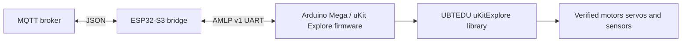

# uKit Explore Arduino Mega SDK integration — agent execution contract

**Status:** implementation plan, not implemented hardware integration. Owner task tree: [#4](https://github.com/vinhphan812/smart-factory/issues/4) → [#56](https://github.com/vinhphan812/smart-factory/issues/56) → [#57](https://github.com/vinhphan812/smart-factory/issues/57) → [#58](https://github.com/vinhphan812/smart-factory/issues/58) → [#59](https://github.com/vinhphan812/smart-factory/issues/59) → [#60](https://github.com/vinhphan812/smart-factory/issues/60).

## Official source material
- [UBTECH how to get SDK](https://ubtechedu.gitbook.io/ukit-explore/ukit-explore-quick-start/get-sdk): Arduino IDE, install library ZIP, select Mega/Mega 2560.
- [Library guide / v1-v2 support](https://ubtechedu.gitbook.io/ukit-explore/standard/ukit-explore-library-file): main controller based on Arduino Mega2560, different V1/V2 headers, required Initialization().
- [Official vendor code](https://github.com/UBTEDU/uKitExplore-library): library.properties declares version 1.2.28-1, ArduinoJson (=6.19.5), IRremote (=3.9.0); Arduino sample sketches. Its tree does not visibly contain a root LICENSE (license and redistribution approval remain to be checked).

## Baseline: do not overwrite this
Existing `esp32-ukit-bridge/esp32/` uses ESP32-S3 + MQTT JSON-to-AMLP v1. Existing `esp32-ukit-bridge/ukit/` uses portable native C99 AMLP reference, **not Arduino Mega firmware**. Preserve both and their golden vectors, test environment and current command semantics.

## Architecture and component boundary



The vendor library belongs to the **Mega firmware process**, never to the ESP32 build. The ESP32 and native reference must not suddenly inherit incompatible ArduinoJson dependencies (ESP32 currently uses version 7; upstream uKit library pins 6.19.5).

## Implementation stages

### Stage A — #56: SDK and board reconnaissance
Identify physical board revision V1 versus V2, exact controller, pinout, power, UART and vendor supported signals. For V1 inspect `uKitExplore.h`; for V2 inspect `uKitExplore2.h`. Verify the SDK README, sample code and signatures. Inventory vendor source licensing before copying it into this public repository. Explore serial conflicts in `Initialization()`, vendor macros and use of `Serial`. Arduino Mega typically operates at 5V logic, while ESP32 uses 3.3V: verify **actual board and port** electrical levels and select proper level conversion. No cable or motor motion before bench signoff.

### Stage B — #57: separate firmware target
Recommended new directory:

```text
esp32-ukit-bridge/
  esp32/             # existing, unchanged
  ukit/              # existing C99 portable reference, unchanged
    mega/            # new Arduino firmware target
      platformio.ini
      src/main.cpp
      include/
      test/
```

Use pinned PlatformIO AVR toolchain with board `megaatmega2560`, framework `arduino`. Pin vendor library version/source and transitive dependencies **only after license decision**. Include the verified correct library header and call `Initialization()`; firmware boot should have no unprompted actuator motion. Document a dedicated protocol UART and a separate debug/upload path after confirming vendor pin usage. Avoid flashing real board in CI.

### Stage C — #58: AMLP transport port
Reuse the existing C99 parser/CRC/deduplication and standard profile rather than creating a conflicting proprietary protocol. Implement Arduino `millis()` and `HardwareSerial` adaptation, bounded buffers, nonblocking receive, frame timeout and ACK. Keep serialization identical to golden vectors. Do not print logs onto the AMLP UART. ACK is not physical movement completion.

### Stage D — #59: bounded driver functions
Provide a mockable hardware adapter. Inspect actual vendor API and examples; promising candidates include `setMotorTurn`, `setMotorTurnAdj`, `setMotorStop`, `readMotorSpeed`, `setServoAngle`, `setServoStop`, `readUltrasonicDistance`, `readInfraredDistance`, `readColorRgb`. Confirm V1/V2 availability and units before invoking. Implement one low-risk `CONVEYOR_START`/`CONVEYOR_STOP` pilot with validated physical IDs, speed/angle bounds and local emergency stop. Never equate protocol numeric speed with PWM until calibrated. Enforce one-execution-per-command ID, local watchdog and safe state on reconnect.

### Stage E — #60: CI, evidence, HIL
Compile Mega firmware on clean checkout; run existing C99 native/ESP32-S3 builds and cross-implementation AMLP vectors. HIL with approved voltage, pinout, common ground, level shifting, hard E-stop and operator oversight; record software revisions and real command/ACK/observed telemetry sequence. On missing board/voltage evidence, mark HIL **BLOCKED**, not PASS.

## Agent claim and PR rules
- Work **one child Issue per PR**; check open PRs (#53 especially for bridge lifecycle) to avoid collisions.
- Comment `/claim` on the issue with concrete design, touched paths, mock/hardware tests and ETA; the comment does not automatically assign work.
- First PR #56 must be reviewable documentation + compatibility proof **before** dependent actuator development.
- Every PR must include actual build commands/output, negative tests (malformed CRC, duplicate ID, UART timeout, disconnected sensor, invalid motor parameters), safety impact, evidence level L1/L2/L3/L4, known blockers, and explicit upstream SDK revision.
- No unauthorized vendored code, credentials or firmware flashed to unverified hardware. Device-local E-stop is required regardless of network or AI.

## Exit criteria
`#4` can close only after real board identification, approved vendor build, verified safe UART wiring, an end-to-end bench request↔ACK flow and one verified bounded actuator or approved test device under emergency-stop supervision. The C99 reference alone does not satisfy this criterion.
