# ESP32 - MEGA Wiring

## Required connections

| ESP32       | Direction | MEGA     | Notes                               |
| ----------- | --------- | -------- | ----------------------------------- |
| GPIO17 (TX) | `->`      | RX0      | Data ESP32 sends to MEGA            |
| GPIO18 (RX) | `<-`      | TX0      | Data MEGA sends to ESP32            |
| GND         | `--`      | GND      | Common ground is required            |

```mermaid
flowchart TB
    %% ===== POWER RAILS =====
    P33["<b>ESP32</b><br/>3.3 V Power"]
    P5["<b>MEGA</b><br/>5 V Power"]
    PGND["<b>Both boards</b><br/>GND (Ground)"]
    SHIFT_LV["<b>Level Shifter</b><br/>LV pin = 3.3 V rail"]
    SHIFT_HV["<b>Level Shifter</b><br/>HV pin = 5 V rail"]
    SHIFT_GND["<b>Level Shifter</b><br/>GND pin"]

    P33 --> SHIFT_LV
    P5 --> SHIFT_HV
    PGND --> SHIFT_GND

    %% ===== CH1: ESP TX -> MEGA RX =====
    subgraph TX_PATH["<b>DATA: ESP32 sends command to MEGA</b>"]
        direction LR
        E17["<b>ESP32</b><br/>GPIO17 (TX)<br/>sends data out"]
        C1["<b>Level Shifter</b><br/>CH1 channel<br/>converts 3.3V -> 5V"]
        M_RX["<b>MEGA</b><br/>RX0 (Pin 0)<br/>receives data"]
    end
    E17 -->|"GREEN wire<br/>TX -> RX"| C1
    C1 -->|"GREEN wire<br/>TX -> RX"| M_RX

    %% ===== CH2: MEGA TX -> ESP RX =====
    subgraph RX_PATH["<b>DATA: MEGA sends reply to ESP32</b>"]
        direction LR
        M_TX["<b>MEGA</b><br/>TX0 (Pin 1)<br/>sends data out"]
        C2["<b>Level Shifter</b><br/>CH2 channel<br/>converts 5V -> 3.3V"]
        E18["<b>ESP32</b><br/>GPIO18 (RX)<br/>receives data"]
    end
    M_TX -->|"YELLOW wire<br/>TX -> RX"| C2
    C2 -->|"YELLOW wire<br/>TX -> RX"| E18

    %% ===== Legend =====
    subgraph LEGEND["<b>WIRE GUIDE</b>"]
        direction TB
        L1["GREEN  = TX line (ESP -> MEGA)"]
        L2["YELLOW = RX line (MEGA -> ESP)"]
        L3["BLACK  = GND (both boards + shifter)"]
        L4["RED    = ESP32 3.3V -> Shifter LV"]
        L5["ORANGE = MEGA 5V -> Shifter HV"]
    end

    classDef esp fill:#1565c0,stroke:#0d47a1,stroke-width:4px,color:#fff,font-weight:bold
    classDef mega fill:#4a148c,stroke:#311b92,stroke-width:4px,color:#fff,font-weight:bold
    classDef shift fill:#e65100,stroke:#bf360c,stroke-width:4px,color:#fff,font-weight:bold
    classDef power fill:#37474f,stroke:#212121,stroke-width:3px,color:#fff
    classDef legend fill:#263238,stroke:#455a64,stroke-width:2px,color:#fff
    classDef path fill:#263238,stroke:#455a64,stroke-width:3px,color:#fff

    class P33,P5,PGND power
    class SHIFT_LV,SHIFT_HV,SHIFT_GND shift
    class C1,C2 shift
    class E17,E18 esp
    class M_RX,M_TX mega
    class L1,L2,L3,L4,L5 legend
```



## Logic level problem

| Direction                      | Voltage     | Risk                                              |
| ------------------------------ | ----------- | ------------------------------------------------- |
| MEGA TX0 (5 V) → ESP32 GPIO18 | 5 V → 3.3 V | **Damage** — ESP32 GPIO is not 5 V tolerant       |
| ESP32 GPIO17 → MEGA RX0 (5 V) | 3.3 V → 5 V | **Usually safe** — MEGA recognises 3.3 V as HIGH |

The 5 V → 3.3 V direction **requires a level shifter**. Never connect MEGA TX0 directly to ESP32 GPIO.

## Solution: MX0508 / BSS138 bidirectional level shifter

A cheap (~$1) 4-channel module. Wire each pin:

| MX0508 pin | Connect to              |
| ---------- | ---------------------- |
| `LV`       | ESP32 3.3 V           |
| `HV`       | MEGA 5 V              |
| `GND`      | Common GND             |
| `LV1`      | ESP32 GPIO17 (TX)     |
| `HV1`      | MEGA RX0              |
| `LV2`      | ESP32 GPIO18 (RX)     |
| `HV2`      | MEGA TX0              |

> **Wire colours (example):**
> - GREEN: ESP32 GPIO17 → CH1 → MEGA RX0
> - YELLOW: MEGA TX0 → CH2 → ESP32 GPIO18
> - BLACK: ESP32 GND + MEGA GND → MX0508 GND
> - RED: ESP32 3.3 V → MX0508 LV
> - ORANGE: MEGA 5 V → MX0508 HV

## Alternative: voltage divider (5 V → 3.3 V only)

If no level shifter is available, use a resistor divider on MEGA TX0 → ESP32 GPIO18:

```
MEGA TX0 ─── 1 kΩ ───┬── 2 kΩ ─── GND
                      │
                  ESP32 GPIO18
```

`1 kΩ + 2 kΩ = 3 kΩ` → `5 V × (2/3) ≈ 3.33 V` ✓ — verify with a multimeter before connecting.

This divider is **one-way only** — it cannot replace a bidirectional shifter.

TX always connects to RX; never TX-TX or RX-RX.

## UART parameters

AMLP does not mandate a baud rate at the frame layer. The recommended initial configuration for bring-up is `115200 8N1`, no flow control, but both sides must use the same value.

## Safe bring-up sequence

1. Do not connect TX/RX yet. Power each board independently and measure GND/reference levels.
2. Power off, connect common GND and UART wires with correct direction.
3. Power on and check idle levels with an oscilloscope or logic analyzer if available.
4. Send an AMLP PING command at a low rate; confirm valid ACK and correct CRC.
5. Only after that step, try `CONVEYOR_START` with the load isolated or safely restrained.

## Hardware notes for MEGA (Arduino MEGA 2560)

MEGA runs at 5 V on its digital pins. RX0/TX0 operate at TTL 5 V level.

- **TX0 (MEGA → ESP32):** Must go through a level shifter. Direct connection will damage ESP32 GPIO.
- **RX0 (MEGA ← ESP32):** Safe to connect directly without a shifter in most cases (MEGA's HIGH threshold is ~2.5–3 V).
- **Power:** MEGA is typically powered via its barrel jack or USB at 7–12 V. Do **not** power MEGA from ESP32's rails.
- **Programming:** RX0/TX0 are also used by MEGA's USB-Serial chip. Disconnect the level shifter wires before uploading a sketch to MEGA.
