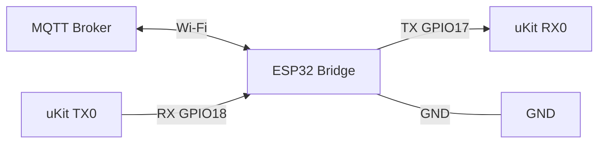

# ESP32-uKit Communication Bridge

A bridge that connects uKit controllers to an MQTT broker via ESP32. ESP32 receives JSON from the broker, converts it to ASCII **AMLP v1** frames sent over UART; in the reverse direction, ESP32 receives ACK and telemetry from uKit.

> `ukit/` is currently a **portable C99 reference endpoint**, not official uKit firmware. The real SDK/toolchain has not been provided yet, so UART/GPIO stubs must be replaced with the manufacturer's API before running on hardware.

## Quick diagram



**Electrical safety:** confirm the UART logic level of both ESP32 and uKit before connecting. ESP32 uses 3.3 V logic; do not assume uKit RX0/TX0 are also 3.3 V. If levels differ, use an appropriate logic level shifter. Always connect common GND.

## Components

- `shared/protocol-spec/`: AMLP v1 specification and shared test vectors.
- `esp32/`: ESP32 bridge firmware.
- `tools/amlp/`: AMLP codec, CLI and TCP simulator in Python 3.11+.
- `tests/python/`: tests for protocol vectors, parser, CLI, simulator and deduplication.
- `ukit/`: portable C99 parser/CRC/ACK/telemetry/dedupe with integration examples.
- `docs/`: architecture, wiring, MQTT contract, development and troubleshooting.

## AMLP v1 at a glance

Canonical wire form:

```
@BODY*CRC4\r\n
```

Examples:

```
@CMD,102,CONVEYOR_START,60*C942\r\n
@ACK,102,OK*22A0\r\n
@TEL,CONVEYOR,RUNNING,60,SENSOR1=1*0942\r\n
```

CRC is **CRC-16/CCITT-FALSE** (`poly=0x1021`, `init=0xFFFF`, `refin=false`, `refout=false`, `xorout=0x0000`) computed over the exact ASCII bytes of `BODY`. Vector `123456789` yields `0x29B1`. Senders emit CRLF; receivers also accept LF-only. Max frame 256 bytes, max 12 fields including `CMD`/`ACK`/`TEL`, each field max 64 bytes.

See canonical spec: [`shared/protocol-spec/AMLP-v1.md`](shared/protocol-spec/AMLP-v1.md).

## Quick start with Python

```bash
python -m venv .venv
# Windows: .venv\Scripts\activate
# Linux/macOS: source .venv/bin/activate
python -m pip install -e ".[test]"
pytest tests/python
```

CLI examples:

```bash
# CRC of the golden vector BODY
python -m amlp crc "CMD,102,CONVEYOR_START,60"

# CONVEYOR_START command with correlation id 102
python -m amlp command --id 102 --name CONVEYOR_START --arg 60

# CONVEYOR_STOP command
python -m amlp command --id 43 --name CONVEYOR_STOP

# Decode a frame (CLI adds LF if the argument has no terminator)
python -m amlp decode "@ACK,102,OK*22A0"

# TCP simulator at 127.0.0.1:8765
python -m amlp simulate --telemetry-interval 1
```

After editable install, the commands `amlp` and `amlp-sim` are also available directly.

## Build C99 reference

Requires PlatformIO Core:

```bash
pio test -d ukit -e native
pio run -d ukit -e native
```

`pio run` only confirms the reference code compiles and runs on a native host. It does not prove compatibility with real uKit hardware.

## Documentation

- [Architecture](docs/architecture.md)
- [Wiring](docs/wiring.md)
- [MQTT contract and AMLP profile](docs/mqtt-contract.md)
- [Development and testing](docs/development.md)
- [Troubleshooting](docs/troubleshooting.md)

## Status and limitations

- Python and C99 use the same AMLP v1 and test vectors as ESP32.
- The official uKit SDK, electrical pinout and flashing procedure have not been provided.
- Default UART settings are `115200 8N1`; confirm with the actual uKit hardware and SDK before integration.
