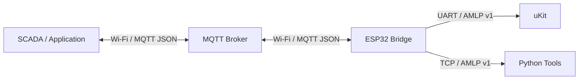

# System Architecture

## Goals

The bridge separates network communication from uKit control logic:

1. ESP32 maintains Wi-Fi/MQTT and converts MQTT JSON to ASCII AMLP frames.
2. uKit processes commands locally, returns ACK and emits telemetry over UART.
3. AMLP provides clear framing, CRC and limits for transmission error detection.



## Implementation Status

| Feature | Status | Evidence |
|---------|--------|---------|
| Command queue (8 entries) | ✅ Implemented | `kCommandQueueCapacity = 8` in `bridge_core.h` |
| Dedup cache (16 entries) | ✅ Implemented | `kDedupeCapacity = 16` in `bridge_core.h` |
| Command allowlist: all 5 commands | ✅ Implemented | `CommandMapper::build()` in `command_mapper.cpp` |
| CONVEYOR_START speed validation 1..100 | ✅ Implemented | `CommandMapper::validSpeed()` |
| SET_OUTPUT channel validation 0..255 | ✅ Implemented | `CommandMapper::validChannel()` |
| CRC-16/CCITT-FALSE accidental-corruption detection | ✅ Implemented | `amlp::encode()` / `crc16_ccitt_false()` |
| Fail-closed auth (no empty credentials) | ✅ Implemented | `connectOnce()` guard in `mqtt_bridge.cpp` |
| Anonymous connection prevention | ✅ Implemented | `connectOnce()` refuses if `username_` empty |
| MQTT broker ACL | ⚠️ Broker-config | Broker ACL required; see `mqtt-security.md` |
| CRC-16 as cryptographic integrity | ❌ Not applicable | CRC-16 detects accidents only; not a security primitive |
| TLS transport | 🔒 Planned | `WiFiClient` used; `WiFiClientSecure` not wired |
| Runtime allowlist (configurable) | 🔒 Planned | Hard-coded in `CommandMapper` |
| Actuator hard limits | 🔒 Planned | MEGA enforces; ESP32-level clamp planned |
| E-stop priority queue bypass | 🔒 Planned | `estop_active_` not implemented |
| SPIFFS device registry | 🔒 Planned | Hard-coded topic names; `device-registry.md` is design-only |
| Exponential backoff for MQTT reconnect | 🔒 Planned | Fixed `kMqttRetryMs` used; `kMqttBackoffInitialMs/MaxMs` unused |

---

## Layer Responsibilities

### ESP32 bridge

- Subscribe to `smart-factory/{deviceId}/command/down`.
- Validate JSON `{ "command_id": number, "request_id": string, "command_name": string, "arguments": [string, ...] }`.
- Encode as `CMD`, placing the correlation ID as the first field and the command name and arguments after.
- Queue, retry the full wire frame, and deduplicate correlation ids.
- Parse AMLP from UART; the first ACK field is used to complete the pending command.
- Publish results and status to `smart-factory/{deviceId}/command/ack`.

### uKit endpoint

- Streaming parser ignores noise until `@`, restarts on new `@`, and accepts both CRLF and LF-only.
- Limits: 256-byte frame, 12 fields, 64-byte field, 250 ms inter-byte timeout.
- Validate syntax and CRC before delivering a frame.
- Bridge profile: process `CMD,<id>,<command>,...`, return `ACK,<id>,<status>`.
- Dedupe the last 8 correlation ids: retrying gets a cached ACK but the handler is not called again.
- Emit `TEL,STATE,...` periodically.

`ukit/` is a portable C99 reference. UART callback, clock, GPIO/sensor must be mapped to the real uKit SDK.

### Python tools

- `protocol.py`: codec following `shared/protocol-spec/AMLP-v1.md`.
- `cli.py`: encode/decode/CRC and bridge-profile command generation.
- `simulator.py`: TCP endpoint for testing the bridge without uKit hardware.

The TCP simulator preserves the AMLP byte stream; only the UART transport is replaced by TCP in the development environment.

## AMLP v1

Wire form:

```
@BODY*CRC4\r\n
```

- `BODY = type *( "," field )`.
- `type` is `CMD`, `ACK` or `TEL`.
- Fields are printable 7-bit ASCII, must not contain `,`, `*`, `@`, CR or LF; must not be empty.
- Senders emit CRLF; receivers must accept both CRLF and LF-only.
- CRC4 is four uppercase hex characters of CRC-16/CCITT-FALSE computed over BODY only.
- Frame max 256 bytes; max 12 fields including type; each field max 64 bytes.
- A new `@` always discards any partial frame and starts a new one.
- A partial frame is discarded if no new byte arrives within 250 ms.

CRC: polynomial `0x1021`, initial `0xFFFF`, refin/refout false, xorout `0x0000`; `123456789 -> 0x29B1`.

Standard spec and vectors are at `shared/protocol-spec/`.

## Bridge application profile

AMLP defines framing only; this project adds the following field profile.

### Command

```
CMD,<correlation_id>,<command>[,<argument>...]
```

- `correlation_id`: decimal number 1..4294967295.
- `CONVEYOR_START`: speed argument (e.g. `60`).
- `CONVEYOR_STOP`: no arguments.

### ACK

```
ACK,<correlation_id>,<status>
```

Status: `OK`, `UNKNOWN_COMMAND`, `INVALID_ARGUMENT`, `INTERNAL_ERROR`.

ESP32 only needs the correlation id field to stop retrying; status is still forwarded for diagnostics and future profile extensions.

### Telemetry

```
TEL,STATE,<uptime_ms>,<temperature_centi_c>,<humidity_centi_percent>,<digital_inputs>
```

All values are ASCII decimal strings. Temperature is signed in hundredths of °C; humidity is unsigned in hundredths of percent; digital inputs is a 16-bit bitmask.

## Correlation, retry and deduplication

- MQTT `id` becomes the first field of `CMD` and `ACK`.
- ESP32 retries the exact wire frame so the correlation id never changes.
- uKit caches results for the last 8 ids; duplicate frames get a cached ACK but the handler is not invoked a second time.
- Do not reuse an `id` for a different command while it could still be in a queue or cache.

## Safety Boundaries

The system implements multiple independent layers of defence-in-depth. Full threat modelling, fail-safe policy, AI command safety rules, watchdog configuration, and recovery procedures are documented in [Threat Model and Safety Policy](./threat-safety-model.md).

Key boundaries:

| Boundary | Mechanism |
|---|---|
| MQTT transport | Broker ACL restricts publish access to `smart-factory/{device_id}/command/down` to authorised clients only |
| ESP32 input validation | Field count, string length, allowed character set, command allowlist, argument range checks |
| AMLP framing | CRC-16/CCITT-FALSE checksum; inter-byte 250 ms timeout; 256-byte frame limit; 12-field limit |
| MEGA actuator limits | Hard speed clamp 1..100; watchdog timer; `INVALID_ARGUMENT` returned for out-of-range values |
| Telemetry isolation | Telemetry parser is read-only; has no access to command queue or actuator control |
| ESP32 RAM | All state (queue, cache, pending) in static/fixed-size RAM; no dynamic allocation in ISR context |
| E-stop | Defined as `CONVEYOR_STOP` command with highest priority; bypasses command queue |
| Fail-closed | Unknown commands and malformed payloads are rejected, never silently ignored or forwarded |
