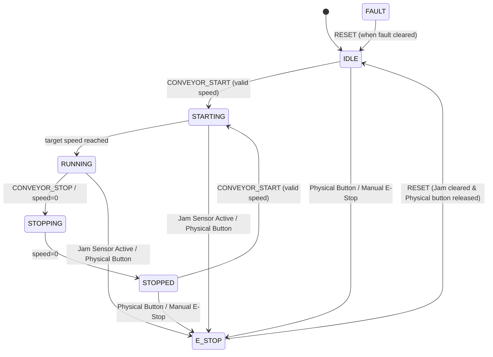

# Conveyor Module Adapter Specification (Issue #22)

**Module:** `factory-control/src/adapters/conveyor.py`  
**Status:** Implemented (L1 Unit Tests, L2 Software Simulation) | Hardware L3 Blocked (Issue #98)  
**Standard:** AMLP v1 & `contracts/v1` compliant  

---

## 1. Overview & Responsibilities

The `ConveyorAdapter` provides safe, deterministic control of the Smart Factory Conveyor Belt module (Module 1).

Key capabilities:
- **Finite State Machine (FSM):** Enforces 7 discrete operating states (`IDLE`, `STARTING`, `RUNNING`, `STOPPING`, `STOPPED`, `FAULT`, `E_STOP`).
- **Speed Bounds Enforcement:** Ensures speeds remain within safe operational bounds (default: `10` to `100` mm/s). Rejects negative, zero, and over-range speed values.
- **Fail-Closed Safety Interlocks (ADR-0006):**
  - Photoelectric and mechanical jam sensors automatically trigger an immediate local Emergency Stop (`E_STOP`) with source `JAM_SENSOR`.
  - Physical hardware E-Stop button triggers immediate local Emergency Stop (`E_STOP`) with source `PHYSICAL_HARDWARE`.
- **Physical vs Software E-Stop Distinction:**
  - A software/network `RESET` command can **only** reset software-level trips (such as a jam interlock after obstruction removal).
  - Software commands **CANNOT** clear a physical hardware E-Stop. The physical button must be manually released on-site first.
  - No operator/manual hardware reset evidence is inferred from simulated sensor flags.
- **Idempotency with Payload Binding:**
  - Caches execution results by typed key (`type:id`).
  - Distinguishes numeric `command_id = 0` from missing IDs via explicit `is not None` checks.
  - Binds cached results to command payload (`command_name` + `arguments`).
  - Exact replays return `duplicate=True`. Conflicting reuse with different payloads is rejected with `CONFLICTING_COMMAND_REUSE`.
- **Canonical Telemetry:** Emits telemetry payloads strictly matching `contracts/v1/schemas/telemetry.schema.json`.

---

## 2. State Machine Diagram

---

## 3. Command Interface

Inbound commands follow `contracts/v1/schemas/command.schema.json`:

| Command Name | Arguments | Description | Failure Codes |
|---|---|---|---|
| `CONVEYOR_START` | `[speed]` | Start conveyor at target speed (10–100 mm/s) | `CANNOT_START_IN_ESTOP`, `CANNOT_START_IN_FAULT`, `JAM_SENSOR_ACTIVE`, `PHYSICAL_ESTOP_ACTIVE`, `SPEED_BELOW_MIN`, `SPEED_EXCEEDS_MAX`, `NEGATIVE_SPEED_NOT_ALLOWED`, `INVALID_SPEED_FORMAT` |
| `CONVEYOR_STOP` | `[]` | Decelerate and stop conveyor | None (always safe) |
| `RESET` | `[]` | Reset adapter from E_STOP or FAULT to IDLE | `PHYSICAL_ESTOP_ACTIVE`, `JAM_OBSTRUCTION_PRESENT` |
| `PING` | `[]` | Health check, returns current state and speed | None |

---

## 4. Hardware Pinout Reference (Arduino Mega 2560 & uKit)

| Signal | Device Pin | Logic Level | Description |
|---|---|---|---|
| Motor PWM | Pin D9 | 5V TTL (via driver) | Conveyor belt DC motor drive |
| Optical Entry Sensor | Pin D22 | 5V TTL (active HIGH) | Detects incoming material entering belt |
| Optical Exit Sensor | Pin D23 | 5V TTL (active HIGH) | Detects material reaching downstream station |
| Jam Detection Sensor | Pin D24 | 5V TTL (active HIGH) | Detects mechanical obstruction or backlog |
| Physical E-Stop Relay | Pin D25 | 5V TTL (normally closed) | Hardware emergency stop button loop |

> ⚠️ **HIL Note:** Physical bench validation and flashing are **BLOCKED-L3** pending Issue #98 (uKit Mega board and licensing clearance). Implementation is accepted at L1/L2 simulation level only.

---

## 5. Verification Evidence

- **L1 (Unit Tests):** 14 comprehensive tests in `factory-control/tests/test_conveyor_adapter.py`.
- **L2 (Software Simulation):** Deterministic mock adapter verifies FSM transitions, sensor trips, payload-bound idempotency, and E-Stop isolation.
