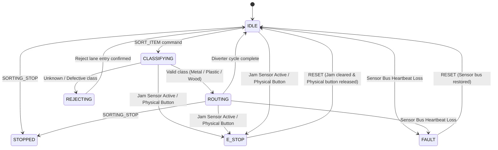

# Sorting Module Adapter Specification (Issue #23)

**Module:** `factory-control/src/adapters/sorting.py`  
**Status:** Implemented (L1 Unit Tests, L2 Software Simulation) | Hardware L3/L4 Blocked (Issue #98 / #9)  
**Standard:** AMLP v1 & `contracts/v1` compliant  

---

## 1. Overview & Responsibilities

The `SortingAdapter` provides deterministic, safety-enforced control for the Smart Factory Sorting module (Module 2). Located immediately downstream of the Conveyor Belt, the Sorting module classifies incoming goods and activates mechanical diverters to route items into designated storage bins or a reject lane.

Key capabilities:
- **Finite State Machine (FSM):** Enforces 7 discrete states (`IDLE`, `CLASSIFYING`, `ROUTING`, `REJECTING`, `STOPPED`, `FAULT`, `E_STOP`).
- **Deterministic Decision Routing:**
  - `METAL` → `BIN_1`
  - `PLASTIC` → `BIN_2`
  - `WOOD` → `BIN_3`
  - `UNKNOWN` / `DEFECTIVE` → `REJECT_LANE` (fail-safe rejection).
- **Item Deduplication:** Tracks processed `item_id`s; duplicate events are acknowledged idempotently and counted only once.
- **Fail-Closed Safety Interlocks (ADR-0006):**
  - Diverter channel jam sensor triggers immediate Emergency Stop (`E_STOP`).
  - Physical E-stop button engagement locks adapter into `E_STOP` with source `PHYSICAL_HARDWARE`.
  - Sensor bus heartbeat timeout / cable disconnect automatically transitions sorter to `FAULT`.
  - Software network `RESET` commands cannot override physical hardware E-Stops; on-site manual button release is required.
- **Canonical Telemetry:** Emits telemetry payloads strictly matching `contracts/v1/schemas/telemetry.schema.json`.

---

## 2. State Machine Diagram

---

## 3. Decision Matrix

| Item Classification | Detection Source | Target Destination | Production Counter |
|---|---|---|---|
| `METAL` | Inductive sensor (Pin D26) | `BIN_1` (Diverter angle: -45°) | `counts.bin_1_count` |
| `PLASTIC` | Color code = 1 | `BIN_2` (Diverter angle: 0° / Straight) | `counts.bin_2_count` |
| `WOOD` | Color code = 2 | `BIN_3` (Diverter angle: 45°) | `counts.bin_3_count` |
| `DEFECTIVE` | Quality inspection flag | `REJECT_LANE` (Diverter angle: 90°) | `counts.reject_count` |
| `UNKNOWN` | Unmatched sensor pattern | `REJECT_LANE` (Diverter angle: 90°) | `counts.reject_count` |

---

## 4. Command Interface

Inbound commands follow `contracts/v1/schemas/command.schema.json`:

| Command Name | Arguments | Description | Failure Codes |
|---|---|---|---|
| `SORT_ITEM` | `[item_id, item_class]` | Classify and route item to bin or reject lane | `CANNOT_SORT_IN_ESTOP`, `CANNOT_SORT_IN_FAULT`, `JAM_SENSOR_ACTIVE`, `SENSOR_LOSS_FAULT` |
| `ROUTE_MANUAL` | `[destination]` | Manually set diverter position (`BIN_1`, `BIN_2`, `BIN_3`, `REJECT_LANE`) | `MISSING_DESTINATION`, `INVALID_DESTINATION` |
| `SORTING_STOP` | `[]` | Stop sorter operations | None (always safe) |
| `RESET` | `[]` | Reset adapter from E_STOP or FAULT to IDLE | `PHYSICAL_ESTOP_ACTIVE`, `JAM_OBSTRUCTION_PRESENT`, `SENSOR_LOSS_ACTIVE` |
| `PING` | `[]` | Health check, returns state and counts | None |

---

## 5. Hardware Pinout Reference (Arduino Mega 2560 & uKit)

| Signal | Device Pin | Logic Level | Description |
|---|---|---|---|
| Diverter Servo PWM | Pin D10 | 5V TTL (PWM) | Controls diverter gate angle (-45° to 90°) |
| Inlet Optical Sensor | Pin D25 | 5V TTL (active HIGH) | Detects item entering sorting station |
| Inductive Metal Sensor | Pin D26 | 5V TTL (active HIGH) | Detects metallic material |
| Diverter Jam Sensor | Pin D27 | 5V TTL (active HIGH) | Detects mechanical blockage in sorting channel |
| Physical E-Stop Relay | Pin D28 | 5V TTL (normally closed) | Hardware emergency stop loop |

> ⚠️ **HIL Note:** Physical bench validation and flashing are **BLOCKED-L3** pending Issue #98 (uKit Mega board and licensing clearance). Implementation is accepted at L1/L2 simulation level only.

---

## 6. Verification Evidence

- **L1 (Unit Tests):** 21 passing tests in `factory-control/tests/` (14 sorting tests + 7 conveyor tests).
- **L2 (Software Simulation):** Verified auto-classification, reject routing, item deduplication, jam interlocks, and sensor bus loss fault transitions.
